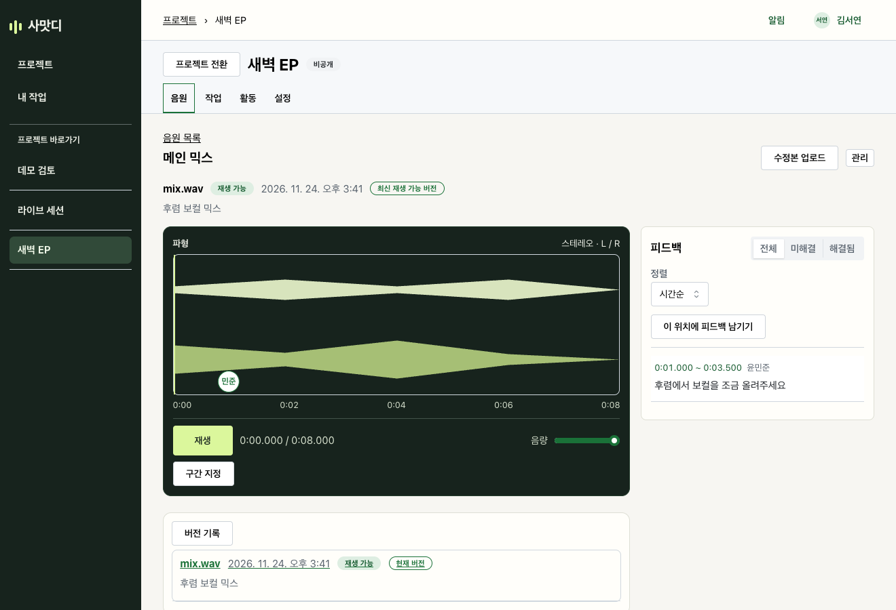
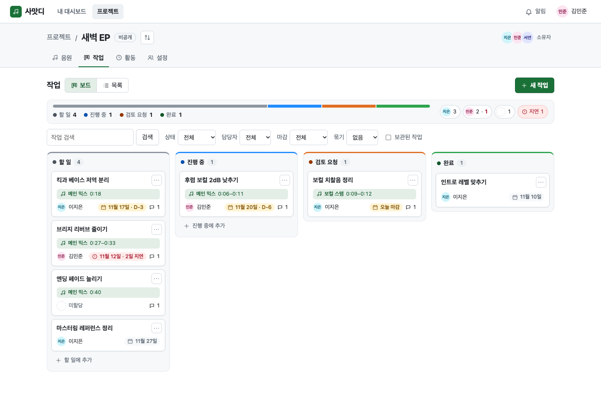
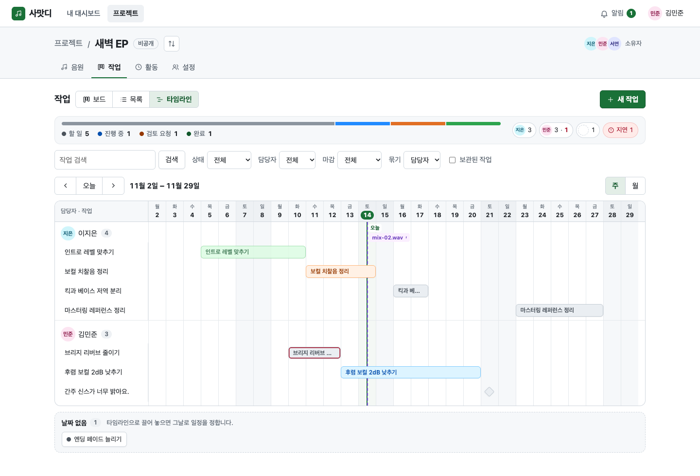
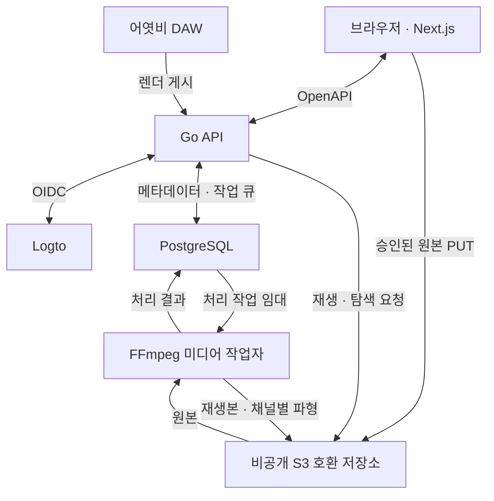

# 사맛디 (Samtdi)

**음원의 정확한 순간에 피드백을 남기고, 수정 작업부터 다음 버전 검토까지 연결하는 음악 협업 플랫폼**

사맛디는 아티스트, 프로듀서, 믹싱 엔지니어가 브라우저에서 음원을 공유하고 함께 검토하는 비공개 음악 작업공간입니다. 음원 파일과 메신저에 흩어진 피드백, 수정 요청, 담당자와 마감일을 한 프로젝트에서 관리합니다.

**Next.js · React · TypeScript · Mantine · Go · PostgreSQL · S3 · FFmpeg**



[핵심 기능](#핵심-기능) · [기술 구조](#기술-구조) · [로컬 실행](#로컬-실행) · [검증 현황](#검증-현황)

## 왜 만들었나요?

"후렴 시작할 때 보컬을 조금 올려 주세요."라는 메시지를 받으면 제작자가 음원을 다시 열고 어떤 부분인지 찾아야 합니다. 새 수정본이 도착하면 예전 버전에 남긴 피드백인지 확인하는 일도 필요합니다.

사맛디는 피드백을 **특정 음원 버전의 재생 위치 또는 구간**에 연결합니다. 피드백에서 바로 할 일을 만들고 수정본을 올린 뒤 다시 검토할 수 있도록 제작·검수 흐름을 구성했습니다.

## 핵심 기능

| 기능 | 할 수 있는 일 |
| --- | --- |
| 음원 리뷰 | 모노·스테레오(L/R) 파형, 재생·탐색, 시간점·구간 지정, 정확한 위치 공유 |
| 피드백 | 타임코드 노트, 답글, 미해결·해결 상태, 해당 위치로 이동, 피드백 링크 |
| 버전 관리 | 원본·수정본 이력과 처리 상태, 이전 버전의 음원·피드백 보존 |
| 작업 관리 | 피드백과 연결된 카드, 담당자·시작일·마감일, 리스트·칸반 보드·일정 타임라인 |
| 내 작업 | 담당 작업, 검토 대기, 예정된 마감, 지연 작업, 프로젝트 활동·알림 |
| 팀 협업 | Logto 기반 로그인, 개인·팀 작업공간과 프로젝트 초대, 소유자·편집자·검토자 권한 |
| 제작 연동 | 어엿비에서 렌더한 믹스 게시, 편집 스냅샷 출처, 커밋 리뷰 탐색 |

### 1. 파형 위에 직접 피드백

음원을 올리면 서버가 재생용 파일과 파형 데이터를 준비합니다. 사용자는 파형에서 특정 위치나 구간을 선택해 피드백을 작성하고 그 구간을 다시 들을 수 있습니다.

시간 좌표는 밀리초 단위이며, 기존 피드백은 작성한 버전과 함께 보존됩니다. 수정본이 올라와도 이전 버전의 코멘트를 새로운 음원 시간으로 덮어쓰지 않습니다.

### 2. 피드백을 수정 작업과 일정으로

피드백을 할 일로 연결하고 담당자·마감일을 지정합니다. 보드에서 카드를 드래그해 할 일, 진행 중, 검토 요청, 완료 상태를 이동합니다. 타임라인에서는 담당자별 제작 일정을 확인하고 날짜를 조정할 수 있습니다.

| 작업 보드 | 일정 타임라인 |
| --- | --- |
|  |  |

*위 두 화면은 초기 대시보드 개편 단계에서 촬영한 데모 화면입니다. 최신 빌드의 내비게이션·스타일과 다를 수 있습니다.*

[대시보드·타임라인 설계와 통합 기록](docs/collaboration-dashboard-design-plan.md)

### 3. 어엿비와 함께 사용하는 제작 흐름

[어엿비(Ayotbi)](https://github.com/whizzkid1452/Ayotbi)에서 완성한 믹스를 사맛디에 직접 게시할 수 있습니다. 새 음원을 만들거나 기존 음원의 수정본을 추가할 수 있고, 게시 출처에 편집 스냅샷 정보가 남습니다. 같은 렌더에 대한 재게시 요청은 같은 버전 ID를 사용합니다.

사맛디는 어엿비 없이도 파일을 직접 업로드해서 사용할 수 있습니다.

[어엿비 게시 API 구현](https://github.com/whizzkid1452/Samtdi/pull/57) · [게시 연동 검증](https://github.com/whizzkid1452/Ayotbi/pull/165)

## 기술 구조

웹은 Next.js로 구성하고, Go API가 프로젝트·권한·음원 버전·작업 등 도메인 데이터를 관리합니다. 미디어 처리 작업자는 API와 분리되어 있으며 원본 파일과 재생본을 객체 저장소에 보관합니다.



### 주요 기술적 선택

| 영역 | 구현 방식 |
| --- | --- |
| 파형과 재생 | 서버의 채널별 peak 데이터 + wavesurfer.js. HTML 오디오 시간을 기준으로 플레이헤드를 보간하고 탐색·정지·버퍼링에서 실제 위치로 재동기화합니다. |
| 미디어 처리 | 임시 업로드 승인으로 브라우저가 객체 저장소에 원본을 전달합니다. 별도 FFmpeg 작업자가 형식 검증, 재생본·파형 생성을 수행합니다. PostgreSQL 작업 임대와 제한된 재시도로 작업 중복 확정을 방지합니다. |
| 버전과 정합성 | 음원 버전 ID에 노트와 렌더 출처를 연결합니다. 오래된 revision의 작업 수정은 거절하고 최신 상태를 다시 불러옵니다. |
| 인증과 권한 | Logto OSS의 OIDC·조직 소속과 Go의 프로젝트별 권한을 함께 확인합니다. 비공개 미디어 재생·반출에도 접근 권한을 적용합니다. |
| API 계약 | OpenAPI 문서에서 TypeScript 타입을 생성해 프론트엔드와 Go 서비스의 요청·응답 계약을 관리합니다. |
| UI | Mantine 공통 테마, Pragmatic drag and drop 기반 칸반 조작, 반응형 리뷰·프로젝트 화면 |

### 기술 스택 및 코드 둘러보기

| 영역 | 기술 | 소스 |
| --- | --- | --- |
| Frontend | Next.js App Router, React, TypeScript, Mantine, wavesurfer.js | [`apps/web`](apps/web/) |
| Backend | Go 1.25, pgx, PostgreSQL | [`services/collaboration`](services/collaboration/) |
| Storage·Media | S3 호환 객체 저장소, Versity Gateway(로컬), FFmpeg·FFprobe | [미디어 작업자](services/collaboration/web_media_worker.go) |
| Auth | Logto OSS, OIDC | [인증 설정](docs/logto-local-setup.md) |
| API·검증 | OpenAPI, Playwright, Go 테스트 | [`contracts`](contracts/) · [`tests`](tests/) |
| 운영 | Docker Compose, systemd, Caddy 예시 | [`ops`](ops/) |

협업 Go 서비스는 [어엿비의 기존 협업 서비스](https://github.com/whizzkid1452/Ayotbi/tree/562f8d00221c003ca1224fa87edca2b061b8c586/services/collaboration)에서 분리했습니다. 기존 네이티브 Git/LFS 및 리뷰 렌더 계약과 호환되는 경로를 유지합니다. 리뷰 렌더의 render.json v2는 sourceDocumentHash와 리뷰 대상 커밋의 project.json SHA-256이 일치해야 저장됩니다.

## 로컬 실행

### 1. 준비

Go 1.25, Node.js 22.6 이상, pnpm 10.15, Docker Compose, AWS CLI, FFmpeg·FFprobe가 필요합니다.

저장소 루트에서 개발용 PostgreSQL·S3 Gateway·Logto를 실행합니다. 첫 실행이라면 [Logto 초기 설정](docs/logto-local-setup.md#로컬-설정)에서 관리 앱을 구성하고 `.local/logto.env`를 생성하세요.

```sh
docker compose -f ops/compose.yaml up -d --wait
set -a
. ops/local.env
. .local/logto.env
set +a
# 버킷이 없을 때 최초 한 번만 생성합니다.
aws --endpoint-url "$AYOTBI_S3_ENDPOINT" s3 mb "s3://$AYOTBI_S3_BUCKET"
```

### 2. API와 미디어 작업자 실행

설정한 환경을 유지한 터미널에서 API를 시작하고, 별도 터미널에서 같은 환경으로 미디어 작업자를 실행합니다.

```sh
# API (저장소 루트)
cd services/collaboration
go run ./cmd/ayotbi-collaboration
```

```sh
# 미디어 작업자 (새 터미널, 저장소 루트)
set -a
. ops/local.env
. .local/logto.env
set +a
cd services/collaboration
go run ./cmd/ayotbi-collaboration media-worker
```

### 3. 웹 실행

다른 터미널에서 저장소 루트를 기준으로 실행합니다.

```sh
cd apps/web
pnpm install --frozen-lockfile
pnpm dev
```

[http://127.0.0.1:3100](http://127.0.0.1:3100)에서 접속합니다. 초기 인증 설정 때 `--demo`를 선택했다면 [로컬 데모 계정 안내](docs/logto-local-setup.md#로컬-설정)를 참고하세요. API 상태는 `http://127.0.0.1:8080/livez`와 `/readyz`에서 확인할 수 있습니다.

로컬 Compose 자격 증명과 개발용 계정은 운영 환경에 사용하지 않습니다. 현재 로컬 설정의 음원 한도는 파일당 500 MB, 30분, 모노·스테레오입니다.

## 검증 현황

```sh
# Web
cd apps/web
pnpm lint
pnpm test
pnpm typecheck
pnpm build
```

```sh
# 격리 PostgreSQL을 사용하는 서버 검사 (저장소 루트)
ops/verify-web.sh
```

기존 파일럿 검증에서는 서로 다른 Chrome·Firefox 계정으로 초대, WAV 업로드, 타임코드 피드백, MP3 수정본, 작업 상태 이동과 알림을 확인했습니다. 모바일 크기 WebKit에서도 오디오와 노트 작성을 확인했습니다. 권한 철회, 오래된 수정 요청 거절, 손상 음원의 처리 실패 및 이전 재생 가능 버전 보존, 별도 DB·버킷 복원도 검사했습니다.

어엿비 게시 통합 검증에서는 7초 스테레오 WAV의 신규·수정본 게시, 재시도 중복 방지, SHA-256 일치, L/R 파형과 브라우저 재생을 확인했습니다. 운영 인증·HTTPS, 실제 모바일 기기, 운영 규모의 부하 및 제작팀 파일럿은 별도 검증 대상입니다.

[파일럿 검증 결과 및 재현](docs/web-pilot-verification.md) · [화면별 구현·검증 기록](docs/figma-screen-audit.md) · [운영과 복원](docs/web-operations.md)

## 개발 문서

| 주제 | 문서 |
| --- | --- |
| 제품·설계 | [웹 구현 계획](docs/web-implementation-plan.md) · [음원 리뷰 UX](docs/audio-review-ux-plan.md) · [협업 대시보드](docs/collaboration-dashboard-design-plan.md) |
| 인증 | [Logto 로컬 설정과 계정 이관](docs/logto-local-setup.md) |
| 미디어·네이티브 연동 | [협업 전략](docs/web-collaboration-strategy.md) · [네이티브 호환 검사](ops/verify-collaboration.sh) |
| 운영 | [운영·백업·복원](docs/web-operations.md) |
| 라이선스 | [외부 라이선스 고지](THIRD_PARTY_NOTICES.md) |

이 저장소는 비공개 개발 프로젝트입니다.
