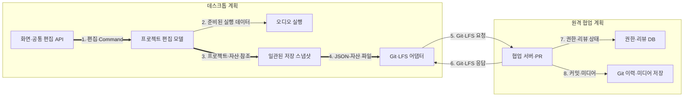
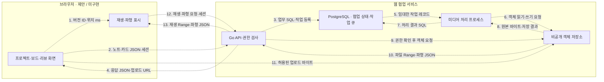

# 사맛디(Samtdi) 웹 협업 서비스 전략

기준일: 2026년 11월 8일. 제품·기술 전략 초안 v1.

제품명 갱신: 2026년 11월 12일, 웹 플랫폼 이름은 **사맛디**, 저장소 이름은 **`Samtdi`**로 확정했다. Ayotbi는 향후 연결할 DAW 이름으로 유지한다.

**어떤 DAW에서 만든 곡이든 WAV·MP3로 올리고, 특정 구간의 피드백을 담당 작업과 다음 버전의 검토까지 연결하는 웹 협업 서비스를 먼저 출시한다. 이후 Ayotbi의 프로젝트·커밋·렌더를 연결해 음악 제작의 변경 이유와 결과를 함께 추적한다.**

이 문서는 무엇을 먼저 검증하고, 어디까지 만들며, DAW 연동을 위해 어떤 경계를 유지할지 결정하기 위한 문서다. 대상 독자는 제품을 설계하고 개발하는 사람이다. 구현 완료 보고서나 확정된 사업계획서는 아니다.

2026년 11월 12일 기준의 실행 범위와 확정 결정은 [웹 독립 MVP 구현 계획](web-implementation-plan.md), PR별 변경·선행 관계·검증은 [웹 PR 구현 계획](web-pr-plan.md)에서 관리한다. 웹 화면과 Go 서버를 별도 웹 저장소로 이관하고 비공개 협업 MVP를 먼저 출시하는 방향을 반영했다. 아래의 초기 전략·기준 커밋은 당시 기록으로 보존한다.

현재 웹 구조도와 설계 판단·이유는 별도 [사맛디 (Samtdi) Notion 페이지](https://app.notion.com/41673b56612a814884cdef5a60bd96d8)에서 관리한다. [기존 Ayotbi 페이지](https://app.notion.com/40f73b56612a81dca402d49afe0eec7f)의 13절은 이전 파일럿 전략 기록으로 보존한다.

## 1. 기준과 핵심 결정

기존 방향의 근거는 `origin/main`의 [JUCE 기반 DAW와 Git 협업 최종 개발 계획](https://github.com/whizzkid1452/Ayotbi/blob/e7e9ab241b1c91c782eff302e4b9b6971d68d842/docs/development-plan.md)이다. 확인한 원격 커밋은 `e7e9ab241b1c91c782eff302e4b9b6971d68d842`이며, 해당 트리에는 이 계획 문서만 있다. 작업 브랜치의 추가 문서와 코드를 근거로 `main`의 구현 상태를 추정하지 않는다.

| 구분                      | 내용                                                                                          |
| ------------------------- | --------------------------------------------------------------------------------------------- |
| 사용자가 요청한 방향      | WAV·MP3 업로드, 타임코드 노트, Trello형 대시보드, 타임라인 트래킹, 향후 DAW 연동              |
| 기존 계획에서 확인한 방향 | C++20·JUCE DAW, 자체 프로젝트 모델, Git·LFS, Go·PostgreSQL 협업 서버, 커밋에 연결된 리뷰 WAV  |
| 이 문서의 제안            | 웹 협업 MVP를 독립 출시하고, 실제 제작팀의 반복 사용을 확인한 뒤 DAW 연결과 Git 협업으로 확장 |
| 잠정 가정                 | 초기 고객은 2-5명의 음악 제작팀, 타임라인은 버전·작업 이력 우선, 비공개 프로젝트 기본         |
| 아직 확인하지 않은 것     | 고객 수요, 지불 의사, 운영 비용, 구현 일정, 실제 서비스 성능                                  |

문서에서 제시하는 사용자 규모, 수치와 운영 한도는 초기 실험을 위한 제안이다. 사용자 조사 결과나 이미 달성한 성과로 해석하지 않는다.

### 별도로 기록된 로드맵과의 관계

구조도를 저장할 위치를 확인하는 과정에서 [기존 Notion Ayotbi 로드맵](https://app.notion.com/40f73b56612a81dca402d49afe0eec7f)을 추가로 읽었다. 이 페이지에는 `feature/implementation-plan` 기준의 Next.js App Router·TypeScript, 공개 작품·프로필·A/B, 웹 이후의 유료 리뷰 파일럿이 기록되어 있다. 이는 `origin/main`의 내용과 별도로 관리된 계획이며, 이번 작업에서 그 브랜치의 구현이나 과거 검증을 재확인한 것은 아니다.

**이 문서의 MVP는 비공개 제작팀 파일럿의 최소 범위다. 기존 W01-W10 웹 베타 전체 계획을 대체하지 않는다.** 기존의 공개 작품·SEO·A/B·유료 리뷰 계획은 유지하고, 해당 기능의 완성 전에 좁은 협업 흐름을 검증하는 중간 단계를 제안한다. 팀 구독 역시 기존 유료 리뷰 계획을 대체하는 결정이 아니라 추가 수익화 가설이다. 웹 기술은 기록된 Next.js·Go 구성을 이어가며, 새 전략의 가정과 기존 확정 사항을 구분한다.

### 기존 계획에서 바꾸는 출시 순서

기존 계획은 로컬 DAW와 버전관리를 구현한 뒤 원격 협업을 출시하는 순서다. 웹은 PR 확인과 WAV 청취를 돕는 화면으로 정의되어 있다. 이 문서는 **웹에서 피드백과 작업 관리의 가치를 먼저 검증하는 별도 출시 경로**를 추가한다. DAW 자체의 개발·검증 순서는 유지한다.

| 항목      | 기존 계획                  | 웹 서비스의 선행 MVP                |
| --------- | -------------------------- | ----------------------------------- |
| 진입점    | DAW 프로젝트와 Git 커밋    | 기존 도구에서 출력한 WAV·MP3        |
| 협업 기준 | 브랜치·PR과 프로젝트 변경  | 오디오 버전·노트·작업 카드          |
| 청취 자료 | 데스크톱이 만든 커밋별 WAV | 사용자가 업로드한 파일과 웹 재생본  |
| 최초 가치 | 편집 상태 비교·병합        | 피드백의 위치·담당자·처리 결과 추적 |
| Git·LFS   | 원격 협업의 기반           | DAW 연동 이후 추가                  |

## 2. 해결할 문제와 첫 사용자

먼저 검증할 문제는 “파일을 보낼 수 없다”가 아니다. 제작자가 믹스 파일을 보내고, 협업자가 메신저에 “두 번째 후렴 보컬을 줄여 달라”고 남기고, 다른 도구에서 할 일을 관리할 때 **어느 버전의 어느 구간을 누가 수정했고, 다시 들어본 사람이 확인했는지**가 분리되는 문제다. 이 상황의 빈도와 불편의 크기는 고객 인터뷰로 확인해야 한다.

첫 사용자는 프로듀서·보컬·믹싱 엔지니어 등 2-5명이 한 곡을 함께 만드는 팀으로 잡는다. 서로 다른 DAW를 사용해도 파일만 있으면 참여할 수 있어야 한다. 의뢰인과 제작자의 검수는 같은 흐름으로 수용하되, 계약·견적·결제·전자서명은 초기 제품에 넣지 않는다.

| 역할        | 완료하려는 일                         | 제품이 제공할 연결               |
| ----------- | ------------------------------------- | -------------------------------- |
| 제작자      | 새 믹스를 전달하고 수정 요청을 모으기 | 프로젝트 안의 버전과 노트        |
| 협업자      | 정확한 구간에 의견을 남기기           | 파형·재생 위치·노트 링크         |
| 작업 담당자 | 수정할 부분과 우선순위를 파악하기     | 노트가 연결된 카드·담당자·마감일 |
| 검토자      | 수정된 결과를 듣고 확인하기           | 이전 노트·새 버전·확인 기록      |

첫 출시에서 검증할 핵심 가설은 다음과 같다.

1. 노트에서 재생 위치로 바로 이동하면 피드백의 대상을 다시 설명하는 일이 줄어드는가?
2. 노트를 카드로 연결하면 실제 수정과 재검토까지 제품 안에서 이어지는가?
3. 같은 팀이 다음 버전이나 다음 곡에서도 자발적으로 이 흐름을 사용하는가?

## 3. 제품 포지셔닝과 경쟁 기준

외부 설명은 **“곡의 피드백부터 수정 확인까지 이어지는 협업 공간”**으로 시작한다. “음악용 GitHub”는 장기 제품 방향을 설명할 때 사용한다. 초기 사용자가 커밋·브랜치·PR을 알아야 업로드하고 의견을 남길 수 있는 구조는 피한다.

기능을 합쳤다는 사실만으로 차별화되었다고 주장하지 않는다. Pibox의 공식 문서는 타임코드 댓글, 작업 할당, 파일 버전과 비교를 이미 설명하고 있다. 기능 목록은 직접 경쟁하며, 더 편한 사용 흐름과 실제 반복 사용으로 제품 가치를 확인해야 한다. [Pibox 시작 안내](https://support.pibox.com/en/articles/6197219-first-steps-with-pibox)

| 비교 대상                 | 확인한 참고 기능                                       | 전략에 반영할 판단                                                          |
| ------------------------- | ------------------------------------------------------ | --------------------------------------------------------------------------- |
| Pibox                     | 시간·구간 댓글, 작업 할당, 파일 버전                   | 직접 비교 대상. 타임코드·카드·버전 결합만으로 독창성을 주장하지 않음        |
| SoundCloud                | 파형과 트랙 페이지의 댓글, 파일 교체 후 댓글 표시 조건 | 청취 흐름을 참고하되, 노트가 작성된 버전과 위치를 보존하는 정책을 명확히 함 |
| Trello                    | 시작일·종료일 기반 타임라인과 담당자 등으로 묶는 보기  | 카드 보드와 일정 화면의 기대를 구분하고, 일정 관리의 필요성을 별도 검증     |
| 파일 공유와 메신저의 조합 | 초기 고객 인터뷰에서 확인할 현재 작업 방식             | 익숙한 도구를 바꿀 만큼 탐색·전달·확인 과정이 짧아지는지 검증               |

SoundCloud의 파일 교체 시 댓글 동작과 Trello의 일정 타임라인은 각각 공식 도움말에서 확인했다. 이 비교는 해당 서비스에 다른 협업 기능이 없다는 뜻이 아니다. [SoundCloud 댓글 관리](https://help.soundcloud.com/hc/en-us/articles/15979541572251-Manage-Comments-as-a-Creator), [Trello Timeline view](https://support.atlassian.com/trello/docs/timeline-view)

장기적으로 만들 차별점은 **“피드백 → 수정 작업 → 실제 DAW 변경 → 결과 오디오 → 검토 기록”의 연결**이다. MVP에서는 앞부분의 사용성을 검증하고, 후속 버전에서 Ayotbi의 안정적인 객체 ID와 커밋을 붙인다. DAW 연동은 아직 제공하지 않는 미래 가치이므로 MVP 판매 문구에서 현재 기능처럼 쓰지 않는다.

## 4. MVP 사용자 흐름과 화면

### 대표 시나리오

1. 제작자가 곡 프로젝트를 만들고 협업자를 초대한다.
2. `Mix v1.wav`를 올린다. 처리가 끝나면 파형과 청취 화면이 열린다.
3. 협업자가 `01:23.400`에 “후렴 보컬을 조금 낮춰 주세요”라는 노트를 남긴다.
4. 제작자가 노트를 작업 카드로 연결하고 담당자와 마감일을 정한다.
5. 담당자가 외부 DAW에서 수정한 뒤 같은 오디오 항목에 `v2`를 추가하고 카드에 연결한다.
6. 검토자가 `v1`의 노트와 `v2`를 확인한다. 확인 결과를 남긴 후 카드를 완료한다.
7. 이력 화면에서 최초 요청, 담당자 변경, 새 버전 등록, 확인과 완료를 따라간다.

새 버전이 올라왔다는 이유만으로 기존 노트를 해결 처리하지 않는다. 작업자의 “수정 완료”와 검토자의 “확인 완료”를 구분해야 한다.

### 화면 구성

| 화면          | 첫 화면에서 답해야 할 질문                                           |
| ------------- | -------------------------------------------------------------------- |
| 홈 대시보드   | 참여 중인 곡, 내가 맡은 작업, 검토 대기와 마감 임박 항목은 무엇인가? |
| 프로젝트 보드 | 어떤 작업을 누가 진행하고 있으며 무엇이 검토를 기다리는가?           |
| 오디오 리뷰   | 지금 듣는 버전은 무엇이고, 어느 구간에 어떤 의견이 있는가?           |
| 버전 목록     | 누가 언제 무엇을 바꿨다고 설명했고 어떤 파일을 올렸는가?             |
| 작업 이력     | 노트·업로드·담당자·상태가 어떤 순서로 바뀌었는가?                    |

프로젝트 보드는 `할 일 → 진행 중 → 검토 요청 → 완료`의 네 상태로 시작한다. 카드에는 제목, 담당자 한 명, 선택적인 마감일, 관련 노트와 결과 버전을 표시한다. 컬럼 이름·워크플로 자동화의 자유로운 커스터마이징은 후속으로 둔다.

### 세 가지 시간축

| 시간축      | 예시                                    | 초기 범위                                            |
| ----------- | --------------------------------------- | ---------------------------------------------------- |
| 오디오 위치 | 곡 시작 후 83.4초, 83.4-88.0초 구간     | MVP 필수. 파형과 타임코드 노트                       |
| 작업 이력   | 오늘 14시에 v2 업로드, 15시에 검토 요청 | MVP 필수. 서버에 기록된 이벤트 순서                  |
| 일정        | 보컬 수정의 시작일·마감일과 작업 겹침   | MVP는 마감일·지연 표시. 간트형 일정 보기는 다음 단계 |

여기서 “타임라인 트래킹”은 우선 작업 이력으로 해석했다. 납기·병행 작업 조율이 첫 고객의 핵심 문제로 확인되면 시작일과 간트형 보기를 MVP에 포함하는 방향으로 범위를 재조정한다. 오디오 시간과 달력 시간을 같은 필드나 화면 축으로 다루지 않는다.

## 5. 출시 범위와 보류 항목

| 기능          | MVP에 포함할 동작                                           | 다음 단계로 남길 동작                           |
| ------------- | ----------------------------------------------------------- | ----------------------------------------------- |
| 프로젝트·초대 | 로그인, 비공개 프로젝트, 역할별 접근, 초대 링크             | 공개 프로젝트 검색, 조직·다단계 팀 관리         |
| 오디오 업로드 | WAV·MP3, 진행·실패·재시도, 파일 검증, 파형·재생본 생성      | 영상·범용 파일 관리, 외부 드라이브 동기화       |
| 리뷰          | 지점·구간 노트, 답글, 해결·재개, 버전·위치로 이동하는 링크  | 음성 댓글, 실시간 공동 청취                     |
| 버전          | 같은 오디오 항목의 v1·v2 목록, 변경 설명, 과거 버전 청취    | 정렬·레벨 보정한 A/B, 자동 차이 분석            |
| 작업 보드     | 고정 네 상태, 카드 이동, 담당자·마감일, 노트·결과 버전 연결 | 의존 작업, 자동 일정 계산, 범용 자동화          |
| 이력·알림     | 업로드·노트·담당·상태 이벤트, 담당 작업·답글의 앱 내 알림   | 이메일 요약, 외부 메신저 연결, 복잡한 멘션 규칙 |
| 기본 반출     | 권한 있는 원본 다운로드, 노트·작업 목록의 JSON/CSV 내보내기 | 외부 업무 도구와 양방향 동기화                  |

초기 프로젝트는 곡 한 개를 기준으로 한다. 곡 안에는 메인 믹스·보컬 시안처럼 여러 오디오 항목을 둘 수 있고, 각 항목에 버전이 쌓인다. 별도 파일들을 DAW처럼 동시에 재생하거나 믹싱하는 기능은 포함하지 않는다.

브라우저 DAW, Git 호스팅·LFS API, 브랜치·PR·merge, 플러그인 서버 실행, 실시간 동시 편집, AI 자동 수정, 공개 커뮤니티와 결제 시스템은 MVP 밖에 둔다. 초기 모바일 웹에서는 청취·노트·검토를 우선 검증하고, 보드 조작은 데스크톱 웹을 기준으로 한다.

파일 처리의 잠정 운영 한도는 파일당 500 MB, 길이 30분, 모노·스테레오다. WAV는 우선 PCM 16/24-bit와 IEEE float 32-bit, MP3는 CBR/VBR을 검증 대상으로 삼는다. 이 값은 출시 전 수직 검증으로 확정하며, 지원하지 않는 인코딩은 조용히 실패시키지 않고 안내한다.

## 6. 데이터의 기준과 제품 규칙

### 오디오 버전과 노트

업로드된 원본은 덮어쓰지 않는다. 새 파일은 새 버전이 되고, 노트는 작성 당시의 버전에 남는다. 파일명이 같거나 길이가 같다는 이유로 같은 오디오라고 판단하지 않는다.

아래 이름은 책임을 설명하기 위한 개념 이름이다. 기존 웹 구현 계획의 `MediaVersion` 등을 새 타입으로 대체하라는 요구가 아니며, 구현 시 기존 모델과 대응시켜 같은 책임의 모델을 중복 생성하지 않는다.

| 개념         | 소유하는 정보                                    | 연결 원칙                                         |
| ------------ | ------------------------------------------------ | ------------------------------------------------- |
| Project      | 곡 이름, 멤버·권한, 보드                         | MVP는 Git 저장소 없이 존재 가능                   |
| AudioItem    | 메인 믹스·보컬 시안 등 리뷰 대상                 | 프로젝트 아래에 여러 개 존재 가능                 |
| AudioVersion | 원본 자산, 버전 순서, 설명, 작성자, 처리 상태    | 하나의 AudioItem에 소속되며 파일 내용은 불변      |
| MediaAsset   | 객체 위치, 내용 해시, 실제 파일 형식·길이        | 원본과 재생본·파형의 관계를 보존                  |
| NoteThread   | 버전, 지점 또는 구간, 본문·답글, 해결 상태       | 항상 특정 AudioVersion을 참조                     |
| Task         | 작업 상태, 담당자, 마감일, 관련 노트와 결과 버전 | 여러 버전에 걸쳐 진행하되 원래 노트의 기준은 유지 |
| Activity     | 작업 주체, 대상, 동작과 서버 시각                | 성공한 변경과 같은 DB 트랜잭션으로 기록           |

노트 위치는 해당 버전의 원본 오디오 시작을 0으로 하는 정수 밀리초로 저장한다. 범위 노트는 시작·끝 위치를 가진다. 화면의 타임코드 표기와 저장 단위를 구분하며, 파일 길이를 벗어난 위치는 허용하지 않는다. 밀리초 저장은 샘플 단위의 재생 정확도를 보장한다는 뜻이 아니다.

재생본 생성은 무음 제거·시간 늘이기·앞부분 자르기를 하지 않는 것을 기본으로 한다. 파형과 청취용 재생본은 같은 디코딩 기준으로 만들고, 원본 시간과의 대응을 검증한다. MP3의 인코더 지연이나 VBR 때문에 기준이 어긋나면 매핑 정보를 보존하거나 해당 파일을 지원 불가로 표시한다. 기존 노트 위치를 임의로 보정하지 않는다.

v2가 편집으로 짧아졌거나 중간 구성이 바뀌면 v1의 83초 노트를 v2의 83초에 자동으로 옮기지 않는다. 사용자는 v1의 노트를 열어 듣고 v2의 대응 위치를 새 노트나 답글로 연결한다. 향후 자동 위치 추정도 제안으로만 제공하고 원본 연결은 남긴다.

### 작업 완료와 검토

노트 해결 상태와 작업 카드 상태는 독립적으로 저장한다. 카드 하나에 여러 노트가 연결될 수 있고, 노트 하나가 해결되었다고 카드 전체를 자동 완료할 수는 없다. 새 버전 등록도 카드나 노트를 자동 완료하지 않는다.

카드를 `검토 요청`으로 옮길 때 결과 버전 또는 검토할 내용을 함께 남기도록 안내한다. `완료`로 옮길 때 미해결 노트가 있다면 이를 표시하고 명시적인 판단을 받는다. 확인은 운영상 검토 행위이며, 법적 납품 승인이나 원본 편집 상태의 병합을 의미하지 않는다.

### 권한과 기록

| 역할   | 권한                                                 |
| ------ | ---------------------------------------------------- |
| 소유자 | 멤버·권한 관리, 프로젝트 보관·삭제 요청, 편집자 기능 |
| 편집자 | 업로드, 카드 편집, 노트·답글 작성, 노트 해결·재개    |
| 검토자 | 청취, 노트·답글 작성, 본인 노트 해결·재개            |

MVP의 멤버는 해당 프로젝트의 오디오와 협업 기록을 함께 본다. 프로젝트별 비공개가 기본이며, 비로그인 공개 청취 링크와 프로젝트 내부 비밀 댓글은 후속 기능이다. 링크를 전달받았다는 사실만으로 멤버 권한이 생기지 않는다.

노트 본문 편집과 카드 변경은 이력을 남긴다. 실수로 지운 항목은 우선 보관 상태로 전환하고, 원본 영구 삭제는 별도 흐름으로 분리한다. 사용자에게 약속할 최종 보관·백업 삭제 기간은 공개 출시 전에 확정한다.

## 7. 기존 계획과 연결되는 기술 구조

### 기존 문서에 있는 구조

`origin/main`은 편집 모델, 오디오 실행, 저장, Git·LFS, 협업 서버의 책임을 분리한다. 편집 상태는 데스크톱 프로젝트 모델이, Git 이력은 Git이, 권한·PR·댓글은 서버 DB가 기준이 되는 설계다. 아래 그림은 **해당 문서의 계획을 요약한 것**이며 구현된 호출 경로를 확인한 그림은 아니다.

각 영역을 나누는 이유는 웹의 협업 상태와 오디오 실행 상태가 서로 다른 책임을 갖기 때문이다. 웹을 먼저 출시하더라도 오디오 엔진을 서버로 옮길 필요는 없다.

핵심 연결은 프로젝트의 일관된 스냅샷을 공유하고, 협업 서버가 그 버전의 리뷰를 관리하는 것이다. 근거: [전체 구조·상태 소유권과 협업 서버 계획](https://github.com/whizzkid1452/Ayotbi/blob/e7e9ab241b1c91c782eff302e4b9b6971d68d842/docs/development-plan.md#전체-구조와-상태-소유권).

### 웹 MVP 제안 구조

웹의 기준 데이터는 협업 API와 PostgreSQL에 둔다. 파일은 비공개 객체 저장소에 보관하고, 분석·변환은 API 요청과 분리한 작업 프로세스가 맡는다. 클라이언트의 재생 위치와 입력 중인 노트는 일시적인 UI 상태다. Next.js는 화면·서버 렌더링을, Go는 인증·권한·업무 규칙을 맡고 Next.js가 DB를 직접 수정하지 않는다.

이하 웹 구조는 제안 / 미구현이다. 그림의 번호는 경로 추적용이며 병렬 작업 전체의 실행 순서를 뜻하지 않는다. 점선은 제안된 연결을 뜻하며 동기·비동기를 구분하는 기호가 아니다.

별도 처리 프로세스는 오디오 변환이 API 응답을 오래 점유하지 않도록 둔다. 처음부터 여러 마이크로서비스로 나누지 않고 같은 서버 코드베이스의 API 실행과 작업 실행을 분리한다.

| 영역                | 기본 제안                                  | 판단 이유                                                                                 |
| ------------------- | ------------------------------------------ | ----------------------------------------------------------------------------------------- |
| 웹 화면             | Next.js App Router·TypeScript              | 기존 별도 계획을 유지. 서버 렌더링과 브라우저 플레이어·보드의 책임 분리                   |
| 파형·청취           | HTML 오디오 재생과 wavesurfer.js 우선 검토 | 파형·구간 선택을 검증하되 편집 엔진으로 사용하지 않음                                     |
| 협업 API            | Go 단일 서비스                             | 기존 서버 계획을 이어가며 웹과 향후 데스크톱이 같은 협업 API 사용                         |
| 기준 데이터·작업 큐 | PostgreSQL                                 | 권한·버전·노트·카드·이력을 트랜잭션으로 관리. 초기에는 별도 메시지 브로커를 추가하지 않음 |
| 파일                | S3 호환 객체 저장소                        | 원본·재생본·파형을 분리. 업로드는 제한 URL, 재생·파형·다운로드는 Go 권한 경유             |
| 미디어 처리         | FFmpeg 기반의 별도 작업 실행 후보          | 실제 디코딩 검증·메타데이터·청취본 생성. 배포 형태와 코덱 지원은 수직 검증에서 확인       |

wavesurfer.js 공식 문서는 대형 파일의 브라우저 디코딩 메모리 제약, 미리 계산한 파형의 사용, VBR 오디오의 파형 불일치 가능성을 설명한다. 따라서 원본 전체를 브라우저에서 디코딩해야만 리뷰 화면을 열 수 있는 구조를 기본으로 삼지 않는다. [wavesurfer.js FAQ](https://wavesurfer.xyz/docs/#questions)

### 업로드와 실패 처리

업로드 요청은 파일 메타데이터와 권한을 확인하고 임시 저장 위치를 발급한다. 전송 후 서버가 실제 파일을 확인하고 미디어 처리 작업을 등록한다. `업로드 중 → 처리 중 → 사용 가능`을 구분하고, 실패한 단계와 재시도 동작을 표시한다. 확장자나 브라우저가 보낸 MIME만으로 파일 형식과 길이를 신뢰하지 않는다.

원본·재생본·파형의 준비가 확인된 버전만 리뷰할 수 있다. 필수 처리에 실패하면 기존 버전이 계속 사용 가능해야 한다. 업로드 완료 요청과 작업 재실행은 동일한 버전이나 이력을 중복 생성하지 않도록 처리한다. 중단된 임시 파일은 완료된 버전의 참조와 구분해 정리한다.

카드나 노트의 동시 수정은 기준 revision을 확인해 오래된 갱신을 거절하고, 사용자의 작성 내용을 보존한 채 최신 상태와 비교하도록 한다. SSE·WebSocket의 도입 여부와 무관하게 서버가 최종 권한과 동시성 검사를 수행한다. 실시간 공동 편집은 제공하지 않는다.

인증된 사용자도 모든 프로젝트를 읽을 수 있는 것은 아니다. 미디어·파형·내보내기·이력 조회마다 프로젝트 권한을 확인한다. 기존 별도 계획을 따라 재생·파형·다운로드는 Go를 거쳐 제공하고 새 Range 요청에서도 권한을 확인한다. API의 전송 부하가 늘어나는 비용을 감수하되, 직접 재생 URL의 만료까지 접근 철회가 늦어지는 문제를 줄이기 위한 선택이다. 업로드 URL은 짧은 만료와 대상을 제한하며, 멤버십을 잃은 사용자의 업로드 완료 처리는 거절한다. 이미 내려받은 파일을 회수할 수 있다고 약속하지 않는다.

웹 서비스는 DAW와 독립적으로 배포할 수 있게 구성한다. C++ 오디오 엔진을 웹 빌드나 서비스 가동의 필수 의존성으로 만들지 않는다. 이번 작업은 전략 문서와 구조도를 작성하며 저장소 분리, 서버 생성과 배포는 수행하지 않는다.

## 8. DAW 연동으로 이어지는 확장 순서

### 1단계: 파일 기반 협업

임의의 DAW에서 출력한 오디오를 받는다. 웹 Project와 AudioVersion은 Git 저장소나 커밋 없이 생성된다. Git을 도입하기 전에 협업 데이터와 오디오 버전의 독립 ID를 확보한다.

### 2단계: Ayotbi에서 리뷰 버전 게시

데스크톱에서 선택한 웹 프로젝트에 렌더를 게시하는 기능을 추가한다. 데스크톱이 로그인·프로젝트 권한을 확인하고, 저장된 상태와 연결된 렌더를 만든 뒤 기존 웹 업로드 흐름으로 전달한다. 서버가 플러그인을 설치해 대신 렌더하는 구조는 우선하지 않는다.

AudioVersion에는 선택적인 출처 연결을 추가한다. 출처에는 DAW 프로젝트 식별자, 저장 스냅샷 식별자, 연결된 경우의 저장소 ID·커밋 ID, 렌더 범위·시간 기준·설정·엔진 환경을 둔다. 이 연결이 없어도 수동 업로드 버전은 계속 유효하다. 브랜치 이름은 이후 바뀔 수 있으므로 리뷰 대상의 불변 식별자로 사용하지 않는다.

웹은 업로드된 오디오의 해시·처리 성공·게시 권한을 확인할 수 있다. 데스크톱이 제공한 커밋과 실제 소리의 대응까지 서버가 독립적으로 재현·검증했다고 표시하지 않는다. 출처 정보와 검증 범위를 구분한다.

### 3단계: 노트에서 DAW 위치로 이동

웹 노트의 버전과 출처를 이용해 DAW에서 대응 프로젝트·위치를 연다. 곡 중간부터 렌더한 파일은 오디오 0초가 프로젝트 0초와 다르므로 렌더 시작 위치가 필요하다. 초·샘플·tick의 변환 책임은 데스크톱의 시간 모델에 두고, 웹 밀리초 값을 그대로 MIDI tick으로 해석하지 않는다.

프로젝트 버전이 다르면 해당 노트를 이전 버전의 리뷰로 표시한다. 현재 편집 중인 프로젝트를 자동으로 checkout하거나 덮어쓰지 않는다. 안정적인 트랙·클립 ID를 이용한 세부 연결은 실제 대응이 가능한 범위에서 추가한다.

### 4단계: Git 기반 음악 협업

원격 Git·LFS, 음악 객체 diff·merge, PR과 리뷰 WAV 비교를 연결한다. 이 단계부터 Git은 편집 스냅샷의 이력과 브랜치 참조를, 협업 DB는 권한·노트·카드·리뷰를 소유한다. 웹의 오디오 버전 업로드를 Git 커밋으로 취급하거나 작업 카드 완료를 PR 병합으로 취급하지 않는다.

필수 미디어 준비 후 브랜치를 갱신하고, 검토 중인 커밋이 바뀌면 기존 검토가 이전 버전에 대한 것임을 표시한다. 이 경계는 [기존 Git·PR 계획](https://github.com/whizzkid1452/Ayotbi/blob/e7e9ab241b1c91c782eff302e4b9b6971d68d842/docs/development-plan.md#협업-서버와-pr-리뷰)을 유지한다.

## 9. 개발·출시 순서와 통과 조건

달력상의 기간은 개발 인원과 수직 검증 결과를 확인한 뒤 산정한다. DAW의 완성 일정과 웹 MVP의 출시 일정을 하나로 묶지 않는다.

| 단계          | 산출물                                             | 다음 단계로 넘어갈 조건                                                               |
| ------------- | -------------------------------------------------- | ------------------------------------------------------------------------------------- |
| 문제 검증     | 5개 제작팀의 실제 협업 흐름과 익명화한 피드백 사례 | 최소 3개 팀에서 버전·위치·담당·확인 중 반복되는 문제가 관찰되고 파일럿 참여 의사 확인 |
| 수직 검증     | WAV·MP3 업로드 → 재생·파형 → 타임코드 노트         | 한도 내 파일, VBR, 재시도, 권한, 위치 정확도 기준 통과                                |
| 비공개 알파   | 프로젝트·보드·버전·이력의 전체 흐름                | 두 계정이 서로 다른 브라우저에서 v1 피드백부터 v2 확인까지 완료                       |
| 제작팀 파일럿 | 실제 곡과 반복 리뷰 기록                           | 5개 참여팀 중 최소 3개가 2주 안에 두 번의 리뷰 회차 완료                              |
| 웹 공개 베타  | 사용량 관찰, 비용·보관 정책, 복구 절차             | 반복 사용 신호와 팀당 비용을 확인하고 미해결 데이터 보존·권한 결함 없음               |
| DAW 연결      | 렌더 게시와 노트 위치 연결                         | 다른 컴퓨터에서도 게시 버전·출처·위치가 일치하고 기존 수동 업로드 흐름 유지           |

위 숫자는 작은 파일럿의 의사결정 기준으로 제안한 값이다. 통계적으로 시장 수요를 증명하는 표본은 아니다. 기준에 미달하면 기능을 추가하기 전에 초대·업로드·피드백·재검토 중 이탈 지점을 확인한다.

## 10. 검증 시나리오와 관찰 지표

### 기능·운영 검증

| 시나리오                        | 확인할 결과                                                                                       |
| ------------------------------- | ------------------------------------------------------------------------------------------------- |
| WAV·CBR MP3·VBR MP3             | 초반·중간·끝의 기준음을 이용해 파형, 위치 이동, 노트가 같은 구간을 가리키는지 확인                |
| 재생본 변환                     | 무음·길이·시간 기준이 의도치 않게 바뀌지 않음. 초기 위치 오차 목표는 지원 브라우저에서 100ms 이내 |
| 파일 한도·손상·위장 확장자      | 명확한 실패 사유를 표시하고, 기존 버전과 노트는 유지                                              |
| 전송 중단·중복 완료·작업 재시작 | 재시도해도 버전·카드·이력이 중복 생성되지 않음                                                    |
| 중간 구간이 잘린 새 버전        | 이전 노트가 원래 버전에서 유지되고 새 버전의 다른 소리에 붙지 않음                                |
| 카드와 노트 상태                | 노트 해결, 새 버전 등록, 카드 완료가 서로 의도치 않게 연쇄 변경되지 않음                          |
| 두 사람의 동시 갱신             | 오래된 변경이 최신 담당자·노트를 덮어쓰지 않고 초안 보존                                          |
| 다른 프로젝트의 URL 접근        | 미디어·파형·노트·이력·내보내기의 접근 거절                                                        |
| 브라우저 새로고침·기기 변경     | 노트·버전·카드 상태·이력이 서버 저장 상태와 일치                                                  |
| 보관·복구·백업 복원             | 파일 참조와 협업 기록을 함께 복원. DB만 살아 있고 오디오가 없는 상태를 탐지                       |
| 데스크톱·모바일 웹              | Chrome·Safari·Firefox 데스크톱과 iOS Safari·Android Chrome에서 청취·노트 검증                     |

100ms는 피드백 위치 이동을 위한 초기 제품 목표이며 샘플 정밀 편집 목표가 아니다. 지원 브라우저·코덱·길이·네트워크 조건을 기록하고, 충족하지 못한 조합은 지원 범위를 조정한다. 문서 작성 단계에서 이 시험을 실행한 것은 아니다.

### 반복 사용을 판단할 지표

가장 중요한 지표는 **주간 협업 리뷰 회차 완료 수**다. 회차 완료는 같은 프로젝트에서 서로 다른 두 명 이상이 참여하고, 한 버전의 노트가 작업에 연결된 뒤 새 버전과 검토 확인까지 이어진 경우로 정의한다. 단순 재생·업로드·혼자 만든 카드는 별도로 집계한다.

| 지표                  | 정의·해석                                                           |
| --------------------- | ------------------------------------------------------------------- |
| 팀 활성화             | 생성 후 7일 안에 첫 버전과 다른 멤버의 첫 노트가 생긴 프로젝트 비율 |
| 첫 협업까지 걸린 시간 | 프로젝트 생성부터 다른 멤버의 첫 노트까지의 중앙값                  |
| 노트의 작업 연결률    | 미해결 노트 중 작업 카드와 연결된 노트의 비율                       |
| 반복 리뷰             | 첫 협업을 마친 팀이 다음 버전에서도 리뷰 회차를 완료한 비율         |
| 재검토 소요 시간      | 카드의 검토 요청부터 검토자가 확인을 남길 때까지의 시간             |
| 운영 품질             | 업로드·처리 실패율, 재생 실패율, 위치 오차, 복구 성공 여부          |
| 비용                  | 활성 팀당 원본·재생본 저장량, 재생·다운로드 전송량, 처리 시간       |

계측에는 이벤트 이름·시각·비식별 대상 ID를 사용하고 미공개 오디오나 노트 본문을 분석 로그에 복제하지 않는다. 빠르게 끝난 회차가 곧 좋은 음악이나 높은 만족도를 뜻하지 않으므로 인터뷰와 실제 작업 결과를 함께 본다.

## 11. 유입·수익화·비용 전략

### 첫 유입

첫 5개 팀은 반복적으로 시안을 주고받는 제작자·밴드·엔지니어 관계에서 모집한다. 새 도구만 써 달라고 요청하기보다 실제 한 곡의 리뷰 회차를 함께 옮기고, 이전 방식과 비교해 어디에서 혼선이 줄거나 늘었는지 관찰한다. 공개 커뮤니티나 콘텐츠 피드부터 만들지 않는다.

초대받은 협업자가 쉽게 듣고 노트를 남길 수 있어야 팀 단위 도입이 가능하다. 초대받는 모든 사람에게 유료 결제를 요구하는 방식은 초기 실험에서 제외한다. 한국어 안내를 기본으로 하되 지역 시장의 크기나 유료 전환율을 근거 없이 가정하지 않는다.

### 수익화 가설

파일럿은 무료로 운영하면서 반복 사용과 저장·전송 비용을 먼저 확인한다. 기존 Notion 로드맵의 웹 이후 유료 리뷰 파일럿 계획은 유지한다. 별도로 반복 협업에 대한 수익화 가설은 프로젝트 소유 팀이 구독하고 가벼운 검토 참여는 무료로 허용하는 방식이다. 과금 후보는 활성 프로젝트 수, 저장 공간, 장기 버전 보관과 팀 관리다. 정확한 가격과 무료 한도는 아직 정하지 않는다.

미공개 음원의 기본 접근 통제와 기존 원본 반출은 상위 요금제만의 기능으로 만들지 않는다. 저장 한도에 도달하면 새 업로드를 제한하거나 업그레이드를 안내하고, 사용자가 인지하지 못한 채 기존 버전을 삭제하지 않는다. DAW 연동은 반복 사용과 가치가 확인된 뒤 유료 기능 후보로 검증한다.

### 비용을 추정하는 방법

월 비용은 `저장 용량 × 보관 기간 + 재생·다운로드 전송량 + 미디어 처리 + DB·API·백업 운영`으로 나누어 계산한다. 특정 공급자의 현재 요금이나 할인에 의존한 가격표는 이 문서에 넣지 않는다.

예를 들어 48kHz·24-bit·스테레오 PCM 오디오 5분은 헤더를 제외하고 약 86.4 MB다. 같은 길이의 320kbps 오디오는 약 12 MB다. 이는 계산 예시이며 실제 압축 품질이나 운영 비용의 측정값은 아니다. 원본 10개 버전만 보관해도 약 864 MB이고, 재생본·파형·백업은 추가된다.

원본 보존과 청취용 재생본을 분리하고, 내용 해시로 같은 프로젝트 안의 동일 파일 중복을 줄일 수 있게 한다. 프로젝트 간 중복 제거는 접근 제어와 존재 여부 노출을 고려해야 하므로 초기 최적화에서 제외한다. 실제 비용에서 저장·전송·처리 중 무엇이 큰지 확인한 뒤 최적화한다.

## 12. 주요 위험과 다시 결정할 조건

| 위험                          | 초기 대응                                                | 다시 판단할 신호                                              |
| ----------------------------- | -------------------------------------------------------- | ------------------------------------------------------------- |
| 기존 서비스와 기능 중복       | 좁은 제작팀 흐름을 끝까지 검증                           | 기능을 사용해도 다음 회차에 돌아오지 않음                     |
| DAW 연동 전 가치 부족         | 어떤 DAW의 파일도 받는 독립 제품으로 출시                | 자동 게시 없이는 반복 업로드가 거의 일어나지 않음             |
| 피드백이 다시 메신저로 흩어짐 | 노트 링크·카드·결과 버전을 한 화면 흐름으로 연결         | 노트는 생기지만 작업 연결·재검토가 일어나지 않음              |
| 시간 기준 불일치              | 버전 고정·공통 재생 기준·위치 검증                       | 특정 MP3·브라우저에서 오차 목표 초과                          |
| 파일 비용 증가                | 한도·사용량 표시·전송량 관찰                             | 활성 팀당 비용이 예상 과금 단위를 지속 초과                   |
| 미공개 음원 접근 노출         | 비공개 기본·Go를 통한 미디어 권한 검사·제한된 업로드 URL | 다른 프로젝트 접근 또는 권한 철회 결함 발견 시 공개 확대 중단 |
| 보드가 범용 업무 도구로 확장  | 음악 리뷰에 필요한 카드 필드로 제한                      | 일정 충돌이 반복되면 간트 보기를 다음 우선순위로 변경         |
| 파일 버전과 Git 개념 혼합     | 서로 다른 식별자·상태 소유권 유지                        | DAW 연동 시 이전 노트·수동 버전의 마이그레이션 필요 발생      |

당장 확정해야 할 것은 제품명이나 유료 가격이 아니라 **파일 업로드부터 두 번째 버전의 검토까지 이어지는 최소 흐름**이다. 고객 인터뷰와 수직 검증 후 타임라인 범위, 파일 한도, 지원 환경과 일정만 먼저 갱신한다. DAW 연동은 그 흐름을 자동화하고 편집 변경의 근거를 더하는 방향으로 확장한다.

## 참고 자료와 근거 범위

| 자료                                                                                                                                         | 이 문서에서 사용한 범위                                                                   |
| -------------------------------------------------------------------------------------------------------------------------------------------- | ----------------------------------------------------------------------------------------- |
| [Ayotbi 개발 계획, 고정 커밋](https://github.com/whizzkid1452/Ayotbi/blob/e7e9ab241b1c91c782eff302e4b9b6971d68d842/docs/development-plan.md) | 제품 방향, 상태 소유권, Git·LFS, 협업 서버, 리뷰 렌더, 단계별 출시 계획                   |
| [Notion Ayotbi 로드맵·구조도](https://app.notion.com/40f73b56612a81dca402d49afe0eec7f)                                                       | main 외 별도 계획의 존재, 기존 웹 기술·공개 기능·유료 리뷰 결정과 이번 파일럿의 범위 구분 |
| [Pibox 시작 안내](https://support.pibox.com/en/articles/6197219-first-steps-with-pibox)                                                      | 타임코드·작업·파일 버전의 기존 제공 여부                                                  |
| [SoundCloud 댓글 관리](https://help.soundcloud.com/hc/en-us/articles/15979541572251-Manage-Comments-as-a-Creator)                            | 파형 댓글과 교체 파일의 길이 변경 시 댓글 표시 조건                                       |
| [Trello Timeline view](https://support.atlassian.com/trello/docs/timeline-view)                                                              | 카드 시작일·종료일 기반 일정 화면                                                         |
| [wavesurfer.js 공식 문서](https://wavesurfer.xyz/docs/)                                                                                      | 파형·구간 표시, 대형 파일·스트리밍·VBR 관련 제약                                          |

외부 자료는 기준일에 확인한 기능 설명을 근거로 사용했다. 경쟁 서비스 전체 기능을 시험하거나 시장 규모·성과·가격 우위를 검증한 것은 아니다.
