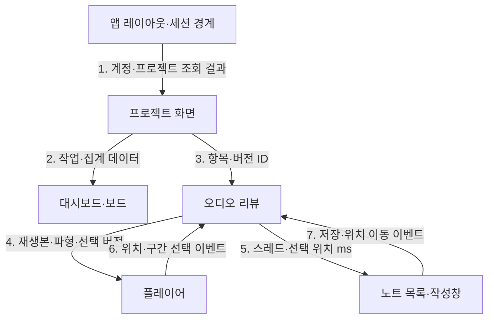
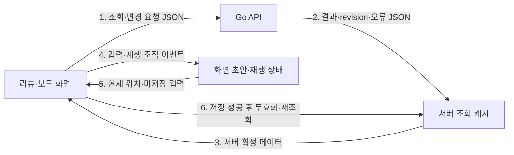
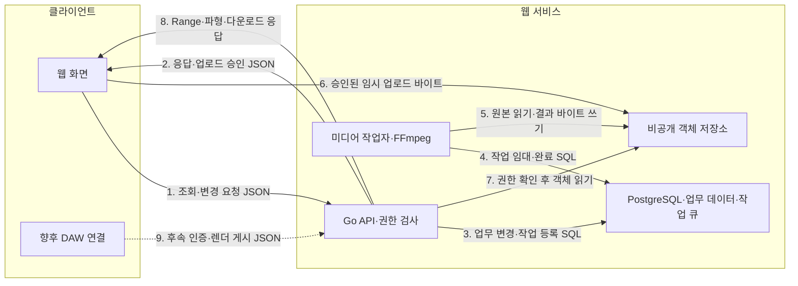
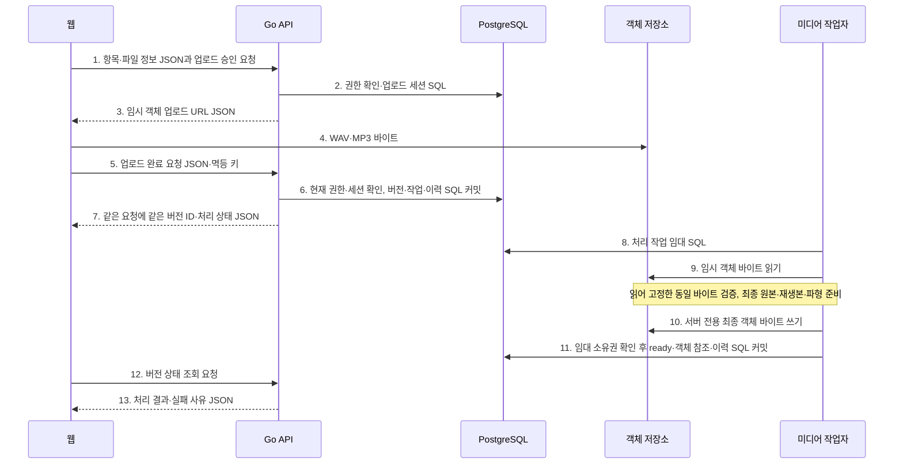

# 사맛디(Samtdi) 독립 MVP 구현 계획

기준일: 2026년 11월 12일. 기준 코드: `origin/main`의 `562f8d00221c003ca1224fa87edca2b061b8c586`.

**DAW 설치 없이 WAV·MP3를 올리고, 특정 구간의 피드백을 작업 배정과 수정본 검토까지 연결하는 비공개 웹 협업 서비스를 출시한다. 웹 화면·서버·미디어 작업자는 별도 웹 저장소에서 함께 관리한다.**

이 문서는 구현할 제품의 범위, 데이터 규칙, 구조와 출시 기준을 정한다. PR별 변경 범위와 선행 관계는 [웹 PR 구현 계획](web-pr-plan.md), 문제·고객·수익화 가설은 [웹 협업 서비스 전략](web-collaboration-strategy.md)에서 관리한다. 이 문서의 목표 구조와 신규 기능은 구현 계획이며, 테스트 통과나 서비스 배포를 뜻하지 않는다.

설계 판단과 이유는 [사맛디 Notion 구조도](https://app.notion.com/41673b56612a814884cdef5a60bd96d8)에서 관리한다. 이 문서는 구현할 범위·계약·순서·검증 기준을 관리한다.

## 1. 확정한 결정과 현재 상태

### 제품·저장소 결정

| 구분      | 결정                                                                  |
| --------- | --------------------------------------------------------------------- |
| 첫 출시   | 비공개 프로젝트의 파일 기반 협업 MVP. Ayotbi DAW는 필수 의존성이 아님 |
| 저장소    | 웹 화면과 기존 Go 협업 서버를 별도 저장소에서 관리                    |
| 저장소명  | `Samtdi`. 초기 비공개를 기본값으로 두며 아직 생성하지 않음            |
| 서버 언어 | 기존 Go 구현을 재사용. Rust 전환은 이번 구현 범위에 포함하지 않음     |
| 첫 사용자 | 2-5명의 제작팀을 초기 가정으로 사용                                   |
| 타임라인  | 버전·작업 변경 이력 우선. 일정은 마감일과 지연 표시까지               |
| 문서 원본 | 저장소의 Markdown. Notion에는 구조와 진행 요약을 연결                 |

### 코드에서 확인한 출발점

| 현재 구현                                                           | 웹 MVP에서의 처리                                           | 근거                                                                                                                                                                   |
| ------------------------------------------------------------------- | ----------------------------------------------------------- | ---------------------------------------------------------------------------------------------------------------------------------------------------------------------- |
| OIDC 로그인, 세션, 초대, 프로젝트, 소유자·편집자·검토자 역할        | 이관·재사용하고 웹 화면 연결                                | [계정·권한](https://github.com/whizzkid1452/Ayotbi/blob/562f8d00221c003ca1224fa87edca2b061b8c586/docs/collaboration-identity.md)                                       |
| 객체 저장소 초기화가 Git 설정을 요구하고 Git 수신은 C++ 도구를 요구 | 웹 필수 모듈과 선택적 Git 모듈의 초기화 분리                | [서버 조립](https://github.com/whizzkid1452/Ayotbi/blob/562f8d00221c003ca1224fa87edca2b061b8c586/services/collaboration/server.go)                                     |
| 기존 리뷰 오디오가 리뷰·커밋·렌더 환경에 연결됨                     | 웹 업로드용 버전 모델을 추가하고 기존 모델은 보존           | [기존 리뷰 미디어 스키마](https://github.com/whizzkid1452/Ayotbi/blob/562f8d00221c003ca1224fa87edca2b061b8c586/services/collaboration/migrations/005_review_media.sql) |
| Go가 제공하는 `/review` 화면과 WAV A/B                              | 기존 Git 리뷰 기능으로 유지. 새 웹 MVP 완료로 집계하지 않음 | [기존 리뷰 화면](https://github.com/whizzkid1452/Ayotbi/blob/562f8d00221c003ca1224fa87edca2b061b8c586/docs/collaboration-review-ui.md)                                 |
| 협업 검사 스크립트가 네이티브 실행 파일·Git·LFS를 요구              | 웹 검사와 네이티브 연동 검사를 분리                         | [현재 통합 검사](https://github.com/whizzkid1452/Ayotbi/blob/562f8d00221c003ca1224fa87edca2b061b8c586/ops/verify-collaboration.sh)                                     |
| 백업 대상 테이블·객체가 기존 Git 리뷰 중심으로 정해짐               | 신규 웹 데이터와 파일 참조를 백업·복원에 추가               | [현재 스냅샷](https://github.com/whizzkid1452/Ayotbi/blob/562f8d00221c003ca1224fa87edca2b061b8c586/services/collaboration/snapshot.go)                                 |

위 표는 현재 소스·문서 확인 결과다. 이번 문서 작성에서 기존 기능 테스트를 다시 실행한 것은 아니다. Next.js 기반의 독립 웹 제품과 수동 업로드·노트·작업 보드는 신규 구현 대상으로 둔다.

### 이전 계획과의 관계

기존 [W01-W10 웹 베타 계획](https://github.com/whizzkid1452/Ayotbi/blob/5a3f05c1493adebe112523c6e0c14869ba85638d/docs/web-feedback-pr-plan.md)은 공개 프로필·작품·댓글·신고·SEO·A/B까지 포함한다. 이번 `WEB-00`부터 `WEB-08`까지는 그보다 먼저 출시할 비공개 협업 범위다. 기존 W 번호와 DAW의 P01-P36 번호를 재사용하거나 완료 상태를 덮어쓰지 않는다.

이번 MVP에서는 네 상태 보드와 검토자의 본인 노트 해결·재개를 적용한다. 과거 W 계획의 세 상태 보드 및 검토자 해결 제한과 차이가 있으므로 이번 문서의 제품 규칙을 기준으로 구현한다.

## 2. 사용자 흐름과 MVP 요구사항

제작자가 프로젝트를 만들고 협업자를 초대한다. `v1.wav`를 올리면 협업자가 파형의 지점·구간에 노트를 남긴다. 제작자는 노트를 작업 카드에 연결하고 담당자를 정한다. 외부 DAW에서 수정한 `v2`를 같은 미디어 항목에 등록하고 카드에 연결한다. 검토 의견과 완료 기록을 남기면 변경 이력에서 전체 과정을 따라갈 수 있다.

| ID    | 포함할 기능                                        | 사용자에게 보이는 완료 결과                               |
| ----- | -------------------------------------------------- | --------------------------------------------------------- |
| MVP01 | 로그인·초대·프로젝트·멤버 권한                     | 초대받은 프로젝트만 열고 역할에 맞게 작업                 |
| MVP02 | WAV·MP3 업로드, 불변 버전, 처리·실패·재시도        | 정상 파일은 재생 가능 상태가 되고 실패해도 이전 버전 유지 |
| MVP03 | 재생·탐색·파형·구간 선택·버전 목록                 | 선택한 버전의 위치를 듣고 이전 버전으로 이동              |
| MVP04 | 타임코드 노트·답글·수정·삭제 표시·해결·재개        | 노트 링크로 원래 버전과 위치를 다시 열기                  |
| MVP05 | 작업 카드·담당자·마감일·결과 버전·보드             | 요청부터 수정과 검토까지 상태 추적                        |
| MVP06 | 홈 대시보드·버전 및 작업 이력                      | 내 작업·검토 대기·마감 임박과 변경 경위 확인              |
| MVP07 | 담당 지정·답글의 앱 내 알림                        | 새 알림을 열어 해당 작업·노트로 이동하고 읽음 처리        |
| MVP08 | 권한 있는 원본 다운로드·노트 및 작업 JSON/CSV 반출 | 서비스 밖에서도 기록과 파일을 보관                        |
| MVP09 | 독립 배포·작업 복구·백업·관측                      | 운영 중단 뒤 데이터와 파일 연결을 복원                    |
| MVP10 | 서버 이관·기존 API 호환·DAW 없는 실행              | 기존 클라이언트 계약을 보존하고 웹만 실행                 |

프로젝트는 곡 한 개를 기본 단위로 한다. 프로젝트 안에 메인 믹스·보컬 시안 등 여러 미디어 항목을 두고 각 항목에 버전을 쌓는다. 여러 파일의 동시 믹싱은 제공하지 않는다.

공개 작품·프로필·공개 댓글·신고·콘텐츠 SEO, A/B, 간트 일정, 결제, 브라우저 DAW, 실시간 공동 편집과 새 DAW 연결 UI는 후속 범위다. 로그인 안내와 기본 사용 가이드는 MVP에 포함한다. 기존 Git 리뷰 기능의 유지와 새 웹에서의 기능 노출은 구분한다.

## 3. 제품 규칙과 데이터 기준

### 권한

| 동작                                         | 소유자 | 편집자 | 검토자 |
| -------------------------------------------- | ------ | ------ | ------ |
| 청취·노트 작성·답글·원본 및 기록 반출        | 가능   | 가능   | 가능   |
| 본인 글 수정·삭제 표시, 본인 노트 해결·재개  | 가능   | 가능   | 가능   |
| 다른 사람 노트 해결·재개                     | 가능   | 가능   | 불가   |
| 업로드·카드 변경·담당·검토 요청·완료 처리    | 가능   | 가능   | 불가   |
| 멤버 초대·역할 변경·제거, 프로젝트 보관·복원 | 가능   | 불가   | 불가   |

전역 운영자 권한만으로 비공개 프로젝트를 읽을 수 없다. API·파형·파일·이력·알림·반출에서 현재 멤버십을 확인한다. 마지막 소유자 보호와 초대 수락 규칙은 기존 구현을 유지한다. 카드 담당자는 프로젝트의 소유자 또는 편집자 한 명이며, 제거·검토자로 역할 변경 시 미할당으로 전환하고 이력을 남긴다.

### 모델과 상태 소유권

| 모델                            | 소유하는 정보와 규칙                                                                 |
| ------------------------------- | ------------------------------------------------------------------------------------ |
| 기존 Account·Project·Membership | 계정·프로젝트·권한의 단일 원본. 별도 웹 계정 체계를 복제하지 않음                    |
| MediaItem                       | 프로젝트 안에서 버전을 모으는 리뷰 대상. 전략 문서의 AudioItem에 대응                |
| MediaVersion                    | 파일 참조·버전 순서·설명·처리 상태. 전략 문서의 AudioVersion에 대응                  |
| MediaAsset                      | 원본·재생본·파형의 객체 참조와 해시·길이·형식                                        |
| UploadSession·MediaJob          | 업로드 만료·완료와 처리 작업의 임대·시도·결과                                        |
| NoteThread·NoteReply            | 특정 MediaVersion의 지점·구간, 본문·답글·해결 상태·수정 revision                     |
| Task                            | 네 상태, 담당자, 마감일, 연결 노트 목록, 선택적 결과 버전·검토 설명·revision         |
| Activity                        | 성공한 변경의 주체·대상·서버 시각과 변경 정보. 업무 변경과 같은 DB 트랜잭션에서 기록 |
| Notification                    | 수신자별 알림·읽음 상태. 이벤트와 수신자 기준으로 중복 생성 방지                     |

PostgreSQL이 협업 데이터의 원본이고 객체 저장소가 미디어 바이트를 보관한다. 화면의 조회 캐시는 서버 데이터를 반영하며, 재생 위치·선택 구간·작성 중인 노트는 해당 화면이 소유한다. 이력은 현재 상태를 재구성하는 이벤트 소싱으로 사용하지 않는다.

### 버전과 시간

- 원본 파일은 덮어쓰지 않는다. 같은 파일명이라도 새 업로드는 새 버전이고, 동일 업로드 완료 요청의 재시도만 같은 버전을 반환한다.
- 노트는 `media_version_id`, `start_ms`, 선택적 `end_ms`로 원본 오디오 시작을 기준으로 위치를 저장한다. 범위는 서버가 확인한 길이 안에서 시작보다 끝이 뒤여야 한다.
- 노트 생성은 재생 가능한 버전에만 허용한다. 편집으로 짧아진 v2에 v1의 노트를 자동 복사하지 않는다.
- 재생본 생성에서 앞부분 자르기·무음 제거·시간 늘이기를 하지 않는다. 파형과 재생본은 같은 시간 기준을 사용하며 MP3 지연·VBR에 따른 차이를 검증한다.
- 다른 버전으로 이동하거나 화면을 떠나면 이전 재생·요청·구독을 정리한다. 늦게 도착한 응답이 현재 버전의 화면이나 재생을 바꾸지 않게 한다.

### 작업과 검토

보드는 `할 일 → 진행 중 → 검토 요청 → 완료`의 네 상태로 시작한다. 상태를 되돌릴 수 있으며 모든 변경을 이력에 남긴다. 노트 해결, 새 버전 등록, 카드 완료는 서로 자동 변경시키지 않는다.

`검토 요청`에는 같은 프로젝트의 재생 가능한 결과 버전 또는 검토할 내용이 필요하다. `완료` 시 미해결 연결 노트가 있으면 사용자가 이를 확인하고 명시적으로 완료를 선택한다. 이 확인 중 카드·연결 노트 상태가 바뀌면 서버가 다시 확인을 요구한다. 검토자는 의견과 본인 노트 상태를 관리하고, 카드의 최종 상태는 소유자·편집자가 변경한다.

마감일은 시각 없는 달력 날짜로 저장한다. MVP의 지연 판단 기준 시간대는 `Asia/Seoul`로 표시한다. 전체 변경 시각은 서버 시각으로 저장하고 화면에서 시간대를 표시한다. 간트의 시작일·의존 관계는 이번 모델에 추가하지 않는다.

노트 삭제는 답글·카드 연결을 남기는 삭제 표시로 처리한다. 프로젝트·미디어·카드는 보관·복원으로 우선 처리하고 연결을 깨는 물리 삭제를 일반 UI에 제공하지 않는다. 보관된 프로젝트는 읽기·반출·복원만 허용한다. 영구 삭제 요청과 백업에서의 삭제 기한은 파일럿 운영 정책으로 명시하고 WEB-08B에서 검증한다.

## 4. 구조와 저장소 이관

### 저장소와 실행 경계

새 저장소의 제안 배치는 다음과 같다. 현재 파일이 생성되어 있다는 뜻은 아니다.

```text
Samtdi/
  apps/web/                 Next.js App Router·TypeScript 화면
  services/collaboration/   이관한 Go API·마이그레이션·미디어 작업자
  contracts/openapi/        HTTP 계약과 웹 타입 생성 기준
  ops/                     개발 실행·배포·검증·복구
  docs/                    전략·구현 계획·PR 계획·운영 기록
```

웹 화면, Go API, 미디어 작업자는 독립 프로세스로 실행한다. 외부에는 같은 HTTPS 출처를 제공하고 경로에 따라 화면 또는 API로 전달한다. Next.js가 업무 DB를 직접 수정하지 않는다. Server Action을 쓰더라도 동일 Go API를 호출하는 화면 어댑터로 한정한다.

WEB-01A에서 기존 서버 전체와 마이그레이션 `001`부터 `006`까지를 이관한다. 원본 커밋과 파일 해시를 기록하고 의미를 바꾸지 않는다. WEB-01B에서 웹에 필요한 인증·프로젝트·저장소 조립과 선택적인 Git·렌더 조립을 분리한다. 기존 Git 기능은 켰을 때 필요한 검증 도구를 계속 요구한다.

기존 저장소의 서버 원본은 새 저장소의 회귀 검증과 고정 릴리스·커밋 소비가 확인된 WEB-01D에서 정리한다. 두 저장소에서 같은 서버에 기능을 따로 추가하지 않는다. 웹 CI는 네이티브 빌드 없이 실행하고, Git·C++ 통합 검사는 별도 작업에서 고정한 호환 버전으로 실행한다.

새 파일럿은 별도 DB·객체 저장소로 시작한다. 기존 운영 배포나 실사용 DB의 존재·주소는 확인하지 않았으므로 코드 이관 과정에서 자동 전환하지 않는다. 기존 배포가 있다면 그 배포의 전환은 복원 시험·클라이언트 호환 확인을 거친 별도 운영 작업으로 기록한다.

### Frontend Architecture

#### Component Hierarchy - 제안 / 미구현



#### State & Data Flow - 제안 / 미구현



재생 위치를 노트·카드의 서버 상태와 같은 전역 저장소에서 매 프레임 갱신하지 않는다. 초기에는 변경 성공·화면 재진입·포커스 복귀 시 재조회하고, 처리 중인 미디어만 중단 가능한 상태 조회를 사용한다. 실시간 공동 편집이나 WebSocket은 MVP 필수 조건이 아니다. 갱신 충돌 시 작성 초안을 보존하고 최신 상태를 보여준다.

### Backend & Infra Architecture

#### System Architecture - 제안 / 미구현



각 모듈은 자신이 소유한 테이블의 변경 규칙을 관리한다. 인증·프로젝트, 미디어, 피드백, 작업·이력으로 책임을 나누되 한 Go 서비스와 DB에서 시작한다. 여러 모듈을 변경하는 사용 사례는 명시적인 호출과 한 DB 트랜잭션으로 묶는다. 그림의 번호는 경로 추적용이며 병렬 실행의 순서를 보장하지 않는다. 점선은 후속 DAW 연결이다.

#### Sequence Diagram - 업로드 완료와 비동기 처리, 제안 / 미구현



DB 트랜잭션과 객체 쓰기는 별개의 작업이다. 객체 쓰기 후 DB 확정이 실패하면 재시도로 같은 결과를 확정하거나 참조 없는 객체를 정리한다. 검증 뒤 다시 변경 가능한 임시 키를 복사해 원본으로 확정하지 않는다. 작업자가 읽어 고정한 바이트와 최종 객체의 해시를 일치시킨다.

작업에는 임대 만료와 재시도 횟수·대기 정책을 두고 변환 중 긴 DB 트랜잭션을 유지하지 않는다. 만료된 임대를 가진 이전 작업자의 결과 확정을 거절한다. 구조적으로 잘못된 파일은 자동 반복하지 않고, 일시적인 저장·통신 실패만 제한적으로 재시도한다. 실제 처리 시간·리소스 측정으로 임대와 제한값을 정해 WEB-03B에 기록한다.

S3 서명 URL은 만료 전 재사용과 같은 키 덮어쓰기가 가능하므로 최종 원본의 불변성을 URL 발급만으로 보장하지 않는다. [S3 서명 URL](https://docs.aws.amazon.com/AmazonS3/latest/userguide/using-presigned-url.html). 여러 작업자가 SQL 큐를 나누어 가져가는 경우에 잠금 건너뛰기를 사용하고 일반 조회의 일관성 정책과 구분한다. [PostgreSQL 잠금](https://www.postgresql.org/docs/current/sql-select.html#SQL-FOR-UPDATE-SHARE).

## 5. API와 호환성

기존 `/v1/auth/*`, `/v1/native/*`, 프로젝트·멤버·초대, Git·LFS·리뷰 API의 경로와 응답 의미를 유지한다. 기존 오류의 `error` 필드와 `X-Request-ID`도 보존한다. 새 필드를 추가한다는 이유만으로 구형 클라이언트 호환이 자동 보장된다고 가정하지 않고 계약 검사를 둔다.

| 신규 계약 묶음              | 주요 동작                                                          |
| --------------------------- | ------------------------------------------------------------------ |
| 프로젝트의 미디어 항목·버전 | 항목 생성·보관·복원, 버전 목록·처리 상태·변경 설명                 |
| 업로드                      | 시작·완료·실패 재시도. 다른 본문에 같은 멱등 키를 재사용하면 충돌  |
| 미디어 전달                 | 현재 권한을 검사한 재생 Range·파형·원본 다운로드                   |
| 버전별 노트                 | 지점·구간 스레드, 답글, 자기 글 수정·삭제 표시, 해결·재개          |
| 프로젝트 작업               | 카드 생성·조회·이동·정렬·담당·마감·결과 버전·보관·복원             |
| 조회·반출                   | 내 작업 요약, 프로젝트 활동 목록, 내 알림·읽음, 노트·작업 JSON/CSV |

신규 경로·요청·응답·오류는 해당 기능 PR에서 OpenAPI와 생성한 TypeScript 타입을 함께 반영한다. JSON 필드 표기는 기존 서버의 `snake_case`를 따른다. ID는 클라이언트가 내부 의미를 해석하지 않는 식별자로 취급한다. 새 ID를 기존 Git commit ID와 혼용하지 않는다.

사용자 변경 요청은 인증, 브라우저 출처, 역할, 프로젝트 소속과 revision을 서버에서 확인한다. 동시 수정 충돌은 최신 데이터를 덮지 않고 반환한다. 부모 노트·버전·카드·담당자 등의 ID를 개별 검증하는 데 그치지 않고 서로 같은 프로젝트의 유효한 관계인지 확인한다. 목록은 안정적인 정렬과 커서 페이지네이션을 사용한다.

기존 마이그레이션 파일을 수정·재번호 부여하지 않는다. 추가 마이그레이션은 빈 DB와 기존 `001-006` 적용 DB 양쪽에서 확인한다. 릴리스 되돌리기는 우선 이전 바이너리로 수행하고 사용자 데이터가 생긴 테이블을 자동 삭제하지 않는다. 비호환 변경이 필요하면 별도 전환 계획을 작성한다.

## 6. 구현 단계와 출시 순서

| 단계   | 산출물                                  | 다음 단계로 넘어갈 조건                             |
| ------ | --------------------------------------- | --------------------------------------------------- |
| WEB-00 | Markdown 계획과 Notion 웹 항목 분리     | 문서 역할·범위·근거·상호 링크 확인                  |
| WEB-01 | 서버 이관·의존성 분리·웹 기반·원본 전환 | DAW 없는 개발·검사 경로와 기존 클라이언트 호환 확인 |
| WEB-02 | 로그인·프로젝트·멤버 화면               | 두 계정이 초대와 역할에 따라 같은 프로젝트 사용     |
| WEB-03 | 업로드·불변 버전·비동기 처리            | 파일 검증·재시도·권한 철회·원본 보존 확인           |
| WEB-04 | 플레이어·파형·버전 목록                 | 지원 파일의 실제 청취·위치 이동 확인                |
| WEB-05 | 타임코드 노트·답글·상태                 | 업로드부터 노트 작성·재접속까지 수직 검증           |
| WEB-06 | 카드·보드·수정본 검토                   | v1 요청부터 v2 검토·완료까지 연결                   |
| WEB-07 | 대시보드·이력·앱 내 알림·반출           | 개인 작업과 변경 경위를 조회하고 기록 반출          |
| WEB-08 | 배포·복원·브라우저 검증·파일럿 기록     | 아래 출시 검증을 통과하고 실제 운영 설정 기록       |

각 단계의 큰 변경은 [PR 계획](web-pr-plan.md)에서 더 나눈다. Activity 쓰기는 WEB-02부터 해당 변경과 함께 구현하고, WEB-07에서 조회 화면을 연결한다. 이력 화면을 나중에 만든다는 이유로 초기 변경 기록을 유실시키지 않는다.

개발 인원·가용 시간·수직 검증 결과가 없으므로 날짜와 소요 주 수는 확정하지 않는다. WEB-05 결과로 파일 처리와 브라우저 지원 범위를 검토한 뒤 남은 일정을 산정한다. DAW 개발 완료를 웹 출시의 선행 조건으로 두지 않는다.

## 7. 검증과 파일럿 진입 기준

초기 검증 한도는 파일당 500 MB, 30분, 모노·스테레오다. WAV는 PCM 16/24-bit·IEEE float 32-bit, MP3는 CBR/VBR을 대상으로 한다. 이는 실측 완료한 지원 목록이 아니며 WEB-03B와 WEB-04에서 확인하고 운영 설정으로 기록한다. 파형은 서버에서 준비해 원본 전체의 브라우저 디코딩에 의존하지 않는다. [wavesurfer.js의 대용량 파일·VBR 안내](https://wavesurfer.xyz/docs/#questions).

| 검사             | 통과 조건                                                                         | 최초 책임 단계     |
| ---------------- | --------------------------------------------------------------------------------- | ------------------ |
| 독립 실행·호환   | Git·JUCE·C++ 도구 없이 웹 실행, 별도 통합 검사에서 기존 API 보존                  | WEB-01             |
| 권한             | 초대 만료·재사용·마지막 소유자·타 프로젝트 접근·멤버 제거 처리                    | WEB-02부터 각 기능 |
| 업로드·작업 복구 | 중복 완료·임대 만료·프로세스 종료·최종 쓰기 실패에도 원본과 정상 버전 유지        | WEB-03             |
| 실제 청취        | 지원 데스크톱 Chrome·Safari·Firefox, iOS Safari·Android Chrome에서 청취·탐색 확인 | WEB-04             |
| 시간 좌표        | 초반·중간·끝의 기준음과 노트 위치 일치. 초기 탐색 오차 목표 100ms 이내            | WEB-04·WEB-05      |
| 버전·노트        | 짧아지거나 구조가 달라진 v2 등록 후 v1 노트·답글·링크 보존                        | WEB-05             |
| 카드 경합        | 동시 이동·편집에서 최신 상태 보존, 멤버 제거 시 미할당·이력 기록                  | WEB-06             |
| 알림·반출        | 수신자·프로젝트 격리, 재시도 중복 방지, JSON·CSV 내용과 원본 참조 일치            | WEB-07             |
| 백업·복원        | 웹 전체 테이블과 참조 원본·파생물을 함께 복원, 누락 객체 검출                     | WEB-08A            |
| 전체 여정        | 서로 다른 브라우저의 두 계정이 v1 노트 → 카드 → v2 검토 → 완료 수행               | WEB-08B            |

100ms는 피드백 탐색의 초기 목표이며 샘플 정밀 편집 보장이 아니다. 실제 브라우저·코덱·파일 길이·네트워크와 오차를 기록한다. 모바일은 청취·노트·검토를 우선하며 보드의 전체 조작 기준은 데스크톱 웹으로 둔다. 드래그만으로 작업 상태를 바꾸게 하지 않는다.

API와 작업자가 모두 운영 잠금·종료 절차에 참여해야 한다. 백업 시 쓰기를 멈추고 진행 중인 작업을 정리한 뒤 DB·객체 목록을 일관된 시점으로 확보한다. 복원은 빈 별도 환경에서 수행하고 사용자에게 재로그인을 요구한다. 복원한 작업 임대는 재획득하게 하며 세션·임시 로그인 상태는 서비스 데이터처럼 복원하지 않는다.

파일럿 전에 실제 OIDC·HTTPS, 배포 출처·스토리지 공급자, 저장량·동시 처리 제한, 원본·백업 보관 및 삭제 정책, 운영 연락처를 기록한다. 아직 제공되지 않은 도메인·비밀·가격·용량을 확정값으로 만들지 않는다. 요청 오류·작업 대기 및 실패·저장량·전송량을 관찰하고 빈 결과를 성공으로 처리하지 않는다.

개발 검증 통과, 배포 완료, 실제 팀의 반복 사용은 별도 상태로 기록한다. 전략 문서의 파일럿 규모와 반복 사용 수치는 실험 제안이며 이번 문서 작성으로 달성된 성과가 아니다.

## 8. 후속 확장과 문서 관리

1. 비공개 파일럿에서 업로드·피드백·재검토의 반복 사용과 운영 비용을 확인한다.
2. 기존 W 계획의 공개 작품·프로필·A/B·공개 댓글·신고를 별도 출시 범위로 진행한다. 유료 리뷰도 별도 운영 실험으로 관리한다.
3. DAW의 렌더 게시를 기존 업로드 API에 연결하고 웹 버전에 프로젝트·커밋·렌더 범위 출처를 붙인다.
4. 노트에서 DAW 위치를 열 때 밀리초와 샘플·tick 변환은 데스크톱 시간 모델에서 수행한다.
5. Git의 편집 스냅샷 이력과 DB의 권한·노트·작업 이력을 각각 유지한다. Git checkout으로 협업 상태를 되돌리지 않는다.

[사맛디 (Samtdi) Notion 항목](https://app.notion.com/41673b56612a814884cdef5a60bd96d8)에 제품 범위·설계 판단과 이유·Frontend Architecture·Backend & Infra Architecture·단계·검증 요약을 작성했다. 기존 Ayotbi 페이지와 분리해 웹 상세를 관리한다.

현재 두 계획 파일은 Ayotbi 저장소에 작성한다. 새 저장소가 준비되면 전략 문서와 함께 이관하고 기존 위치에는 이동 안내를 남긴다. 문서의 소유 위치를 전환할 때 형제 문서 링크와 코드 근거 링크를 확인한다. Markdown 계획과 독립 Notion 항목을 작성했다. 저장소 생성·코드 이관·PR 생성·배포는 아직 실행하지 않았다.
