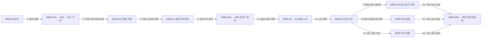

# 사맛디(Samtdi) MVP PR 구현 계획

기준일: 2026년 11월 12일. 기준 코드: `origin/main`의 `562f8d00221c003ca1224fa87edca2b061b8c586`.

**[웹 구현 계획](web-implementation-plan.md)의 WEB-00부터 WEB-08까지를 검토·검증·되돌리기가 가능한 PR 단위로 나눈다.** 각 PR은 필요한 화면·API·데이터·검증을 함께 변경한다. `WEB-*`는 계획 ID이며 GitHub PR 번호가 아니다. 실제 Draft PR은 아래 단계 표에서 확인할 수 있다.

제품 범위·권한·데이터 의미·출시 기준은 구현 계획이 원본이다. 이 문서는 PR의 목적, 선행 관계, 계약 변경과 완료 조건을 관리한다. 고객·사업 가설은 [전략 문서](web-collaboration-strategy.md)를 참고한다.

## 1. 저장소와 PR 운영 원칙

- 문서 준비는 현재 `Ayotbi` 저장소에서 시작한다. 새 제품 구현의 저장소 이름은 `Samtdi`이며 웹 화면·Go 서버·미디어 작업자를 함께 둔다.
- 기존 서버 전체를 의미 변경 없이 먼저 이관한다. 웹 독립 실행을 위한 구조 변경과 기존 저장소의 원본 제거는 별도 PR로 검토한다.
- 같은 서버 코드의 신규 변경은 이관 후 웹 저장소에서만 한다. 이관 중 기존 서버 수정이 생기면 원본 커밋과 이관 커밋의 차이를 다시 대조한다.
- 독립 PR은 대상 저장소의 최신 `main`을 기준으로 한다. 실제 코드 의존성이 있는 같은 저장소의 후속 Draft PR만 선행 브랜치를 base로 삼는다. 서로 다른 저장소의 선행 관계는 고정 커밋·릴리스와 PR 링크로 표현한다.
- 브랜치는 `codex/web-<계획 ID의 숫자 및 접미사>-<작업>` 형식으로 생성한다. 예: `codex/web-03b-media-worker`. 실제 생성 시 해당 저장소의 추가 규칙도 확인한다.
- 기능 검증은 각 PR에서 수행한다. 마지막 통합 PR에 개별 기능의 미구현·권한 검사·오류 처리를 모으지 않는다.
- 프런트엔드 UI가 아직 없는 기반 PR은 실제로 제공하는 API·상태까지 완료 범위로 적는다. 임시 성공 응답이나 가짜 ready 상태를 만들지 않는다.

## 2. PR 목록과 선행 관계

| 계획 ID | PR 목적                                  | 대상 저장소 | 선행 조건                     | 상태                                                        |
| ------- | ---------------------------------------- | ----------- | ----------------------------- | ----------------------------------------------------------- |
| WEB-00  | 문서 기준과 웹 항목 분리                 | Ayotbi·문서 | 없음                          | [Draft #1](https://github.com/whizzkid1452/Samtdi/pull/1)   |
| WEB-01A | 기존 Go 서버와 검증 자산 이관            | Samtdi      | WEB-00의 Markdown 기준        | [Draft #2](https://github.com/whizzkid1452/Samtdi/pull/2)   |
| WEB-01B | 웹 실행에서 Git·네이티브 의존성 분리     | Samtdi      | WEB-01A                       | [Draft #3](https://github.com/whizzkid1452/Samtdi/pull/3)   |
| WEB-01C | Next.js·계약·개발 환경·웹 CI             | Samtdi      | WEB-01B                       | [Draft #4](https://github.com/whizzkid1452/Samtdi/pull/4)   |
| WEB-01D | 기존 저장소의 서버 소비 경로 전환        | Ayotbi      | WEB-01C의 고정 커밋·호환 검사 | [Draft #72](https://github.com/whizzkid1452/Ayotbi/pull/72) |
| WEB-02  | 로그인·프로젝트·멤버 관리 화면           | Samtdi      | WEB-01C·WEB-01D               | [Draft #5](https://github.com/whizzkid1452/Samtdi/pull/5)   |
| WEB-03A | 업로드 승인·완료와 불변 버전 등록        | Samtdi      | WEB-02                        | [Draft #6](https://github.com/whizzkid1452/Samtdi/pull/6)   |
| WEB-03B | 미디어 작업자·파형·재생본·복구           | Samtdi      | WEB-03A                       | [Draft #7](https://github.com/whizzkid1452/Samtdi/pull/7)   |
| WEB-04  | 플레이어·파형·버전 목록                  | Samtdi      | WEB-03B                       | [Draft #8](https://github.com/whizzkid1452/Samtdi/pull/8)   |
| WEB-05  | 타임코드 노트·답글·해결                  | Samtdi      | WEB-04                        | [Draft #9](https://github.com/whizzkid1452/Samtdi/pull/9)   |
| WEB-06  | 노트 연결 작업 카드·보드·검토            | Samtdi      | WEB-05                        | [Draft #10](https://github.com/whizzkid1452/Samtdi/pull/10) |
| WEB-07A | 내 작업 대시보드·활동 이력               | Samtdi      | WEB-06                        | [Draft #11](https://github.com/whizzkid1452/Samtdi/pull/11) |
| WEB-07B | 앱 내 알림·읽음 상태                     | Samtdi      | WEB-06                        | [Draft #12](https://github.com/whizzkid1452/Samtdi/pull/12) |
| WEB-07C | 노트·작업 JSON/CSV 반출                  | Samtdi      | WEB-06                        | [Draft #13](https://github.com/whizzkid1452/Samtdi/pull/13) |
| WEB-08A | 배포·백업·복원·운영 관측                 | Samtdi      | WEB-07A·WEB-07B·WEB-07C       | [Draft #14](https://github.com/whizzkid1452/Samtdi/pull/14) |
| WEB-08B | 전체 여정·실제 브라우저·파일럿 검증 기록 | Samtdi      | WEB-08A                       | [로컬 검증 기록](web-pilot-verification.md)                 |

WEB-07A/B/C는 선행 구현 후 독립적으로 진행할 수 있다. 한 사람이 개발하면 표 순서로 진행한다. Notion 동기화는 문서의 기준 위치를 연결하는 작업이며 웹 빌드의 의존성이 아니다.

### Dependency Diagram - 계획 / 미구현

이 그림의 화살표는 구현 선행 조건이다. API 호출 흐름이나 실제 PR 생성·병합 상태를 뜻하지 않는다.

## 3. PR별 범위와 완료 조건

### WEB-00 - 웹 문서 기준과 항목 분리

- **변경:** 구현 계획·PR 계획을 Markdown으로 작성하고 전략 문서에서 연결한다. Notion `사맛디 (Samtdi)` 항목에는 웹 요약·구조를 분리하고 기존 DAW 설명·검증 기록을 보존한다. Markdown과 Notion 작성 상태를 실제 제품 구현·PR 생성 상태와 구분한다.
- **계약:** 제품 범위와 단계 ID만 정리한다. 기존 W01-W10·P01-P36 번호와 의미는 유지한다.
- **완료 조건:** 최신 기준 커밋·확정 결정·초기 가정·미구현 상태가 구분되고 상호 링크가 유효하다. Notion 저장은 재조회 후 별도로 완료 표시한다.
- **검증:** Markdown 링크·표·코드 펜스·Mermaid 구문, PR 선행 ID와 요구사항 연결 확인. 문서만 변경할 때 제품 빌드 통과를 완료 조건으로 만들지 않는다.

### WEB-01A - 기존 Go 서버와 검증 자산 이관

- **변경:** 별도 웹 저장소를 준비하고 기존 Go 서비스, `001-006` 마이그레이션, 내장 리뷰 화면, 관련 테스트·필수 fixture·운영 도구를 출처와 함께 이관한다. C++ 앱 소스는 복제하지 않는다. 서버 이관과 모듈 경로 변경에 필요한 최소 참조만 바꾼다.
- **계약:** 기존 HTTP 경로·JSON·오류·인증·DB 의미를 유지한다. 신규 웹 기능과 Git 의존성 해제는 포함하지 않는다.
- **완료 조건:** 원본 커밋·파일 해시·의도적 경로 변경 목록을 대조할 수 있고 Go 빌드와 기존 회귀 검사가 재현된다. 네이티브 검사에 필요한 실행 파일은 명시적인 외부 입력으로 받는다.
- **검증:** 로그인·초대·프로젝트·네이티브 코드 교환·Git/LFS·리뷰·백업의 기존 검사, 빈 DB 및 기존 마이그레이션 DB. 필요한 네이티브 검사를 실행하지 못하면 이관 호환 확인을 완료로 표시하지 않는다.
- **복구:** 기존 Ayotbi 서버 원본을 이 단계에서 삭제하지 않는다. 이관 후 새 서버 변경은 웹 저장소에서 관리한다.

### WEB-01B - 웹 실행과 Git 기능의 의존성 분리

- **변경:** 인증·프로젝트·객체 저장소를 웹 필수 모듈로 조립하고, Git 수신·프로젝트 도구·리뷰 렌더는 선택적 모듈로 조립한다. 웹 검사 진입점에서 Git·LFS·C++ 실행 파일 요구를 제거한다.
- **계약:** 객체 저장소만 설정해도 웹 서버가 시작된다. Git 모듈을 켜면 기존 수신 검증·도구 요구를 그대로 집행한다. 사용하지 않는 기능을 성공 응답으로 대체하지 않는다.
- **완료 조건:** 웹 서버는 네이티브 파일 없이 시작하며, Git 기능을 사용하는 기존 구성도 같은 동작을 유지한다.
- **검증:** 웹 최소 구성, DB·스토리지 오류, Git 구성 일부 누락, Git 모듈의 정상 수신 및 무효 수신 거절. 웹 검사 성공과 네이티브 검사의 생략을 혼동하지 않게 결과를 분리한다.

### WEB-01C - Next.js·API 계약·개발 환경·CI

- **변경:** Next.js App Router·TypeScript 화면 기반, Go API 실행 구성, 로컬 PostgreSQL·비공개 S3 호환 환경, 같은 출처의 화면/API 경로, 환경 변수 예시·실행 안내를 구성한다. 실제 미디어 작업자 진입점은 처리 기능과 함께 WEB-03B에서 추가한다.
- **계약:** 기존 `/healthz` 의미를 보존하면서 liveness와 readiness를 구분한다. OpenAPI·웹 타입 생성·계약 검사, 신규 도메인의 멱등성·revision·목록 계약 적용 방식을 정한다. 기존 오류·요청 ID 계약을 재사용한다.
- **완료 조건:** 깨끗한 checkout에서 화면·API·DB·저장소를 실행하고 종료할 수 있다. 웹 CI에 CMake·JUCE 설치가 필요 없다. 사용할 런타임·패키지 버전과 명령은 호환 확인 후 매니페스트·잠금 파일에 고정한다.
- **검증:** 설정 누락·DB 중단·저장소 연결 실패, readiness와 liveness의 구분, API 계약 차이 검출, 웹 타입·린트·빌드, Go 빌드·검사, 프로세스 독립 종료. 가짜 처리 성공 화면은 만들지 않는다.

### WEB-01D - 기존 저장소의 서버 소비 경로 전환

- **변경:** Ayotbi의 협업 검증·운영 문서를 웹 저장소의 고정 커밋 또는 릴리스로 전환한다. fixture와 도구 전달 책임을 정리한 뒤 중복 서버 원본을 제거하고 이동 안내를 남긴다.
- **계약:** 데스크톱이 사용하는 서버 HTTP 계약은 유지한다. C++ 저장 형식이나 DAW UI 변경은 포함하지 않는다.
- **완료 조건:** 기존 검사 환경에서 새 위치의 서버를 사용해 네이티브 연동을 확인하고 소비하는 서버 버전을 추적할 수 있다. 가변 `main`이나 로컬의 우연한 형제 폴더 위치에 의존하지 않는다.
- **검증:** 고정 버전으로 서버 준비, 인증·Git/LFS·리뷰 연동, 기존 서버 폴더 참조의 잔여 검색, 실패 시 이전 고정 버전으로 복귀. 실제 운영 서버·DB의 자동 전환은 하지 않는다.

### WEB-02 - 로그인·프로젝트·멤버 관리

- **변경:** 로그인·로그아웃·초대 수락, 프로젝트 목록·생성·보관·복원, 멤버 초대·역할 변경·제거 화면과 기본 사용 가이드를 연결한다. 기존 API의 부족한 동작만 호환되는 방식으로 추가한다.
- **계약:** 기존 Account·Session·Project·Membership·Invitation을 재사용한다. 성공한 프로젝트·멤버 변경을 같은 트랜잭션의 Activity에 기록하는 기반을 추가한다. 이후 기능도 자신의 이벤트 기록을 함께 구현한다.
- **완료 조건:** 소유자·편집자·검토자가 서버의 역할 규칙대로 사용하고 공개 가입 경로는 없다. 초대 링크는 소유자가 복사해 전달한다. 자동 이메일 발송은 범위 밖이다.
- **검증:** 초대 만료·취소·재사용·이메일 불일치, 기존 사용자 초대 수락, 세션 만료·로그아웃·잘못된 Origin, 마지막 소유자 제거 경합, 타 프로젝트 ID 접근, 보관 후 변경 거절. 운영자도 멤버십 없이 내부 데이터를 읽지 못한다.

### WEB-03A - 업로드 승인·완료와 버전 등록

- **변경:** 미디어 항목, UploadSession·MediaVersion·MediaJob, 파일 선택·전송 진행·중단·실패 화면, 제한된 임시 업로드 URL과 완료 API를 구현한다. 항목 보관·복원과 기존 버전 목록의 최소 상태 조회를 포함한다.
- **계약:** 업로드 시작·완료·목록 API와 작업 입력을 OpenAPI에 추가한다. 완료 시 현재 권한을 다시 확인하고 버전·작업·Activity를 한 트랜잭션으로 기록한다. 완료 요청에는 멱등 키를 적용한다.
- **완료 조건:** 완료된 업로드는 한 개의 처리 대기 버전으로 등록된다. 같은 키·본문의 재요청은 같은 결과, 다른 본문의 키 재사용은 충돌이다. 실제 디코딩·ready 전이는 WEB-03B에서 제공한다.
- **검증:** 전송 중단·만료·완료 요청 유실·동시 재시도, 다른 항목·프로젝트의 세션 대입, 업로드 후 멤버 제거, 비정상 크기 정보, 완료 전 재생 거절. HTTP 요청 안에서 변환을 실행하지 않는다.

### WEB-03B - 미디어 변환·파형·작업 복구

- **변경:** 영속 큐 소비, 임대·종료·재획득·제한 재시도, 실제 파일 분석·형식 검증, FFmpeg 변환, 미리 계산한 파형, 서버 전용 원본·파생물 확정, 실패 사유·재시도 UI를 구현한다. 권한을 검사하는 Range·파형·원본 다운로드 경로를 제공한다.
- **계약:** 검증한 동일 바이트를 최종 객체로 보관하고 필수 결과가 준비된 버전만 ready로 바꾼다. 현재 임대 소유자만 완료할 수 있다. 객체 쓰기와 DB 확정 사이 실패를 복구하고 참조 없는 임시·결과 객체를 구분해 정리한다.
- **완료 조건:** WAV·CBR/VBR MP3의 원본 해시·메타데이터·재생본·파형이 확인된다. 실패해도 이전 ready 버전이 유지된다. 변환은 API와 별도 프로세스에서 실행된다. 처리 시간·리소스 측정에 근거한 제한·재시도 설정을 기록한다.
- **검증:** 손상·위장 형식·한도 초과, 처리 중 종료·임대 만료·오래된 작업자의 완료·중복 작업, 파생물 쓰기 및 DB 확정 실패, 완료 후 업로드 URL 재사용, 잘못된 Range와 권한 철회, 보관과 처리 완료의 경합, 고아 정리 시 참조 보존.

### WEB-04 - 플레이어·파형·버전 목록

- **변경:** 한 플레이어의 재생·정지·탐색, 파형·구간 선택, 버전 목록·변경 설명·원본 다운로드, 로딩·실패·접근 만료 화면을 연결한다. A/B는 후속 범위다.
- **계약:** 서버의 파일 길이·파형·재생 시간 기준을 소비한다. 현재 버전·재생 위치·선택 구간은 화면 상태이며 서버 버전 데이터를 수정하지 않는다.
- **완료 조건:** 지원 브라우저에서 실제 소리를 듣고 초반·중간·끝의 위치를 검증한다. 빠른 버전 전환에도 한 버전만 재생되고 이전 비동기 결과가 현재 화면에 적용되지 않는다.
- **검증:** 긴 파일·VBR·끝 위치·빈 목록·처리 중 파일·네트워크 중단·권한 만료, 화면 이탈과 재생 정리, 키보드 조작, 모바일 청취. 100ms 탐색 목표를 측정 조건과 함께 기록한다.

### WEB-05 - 타임코드 노트·답글·해결

- **변경:** 지점·구간 노트, 답글, 본인 글 수정·삭제 표시, 역할에 따른 해결·재개, 노트에서 해당 버전·위치로 이동하는 링크를 구현한다.
- **계약:** NoteThread·NoteReply와 revision, 버전별 노트·답글·상태 API, 수정 이력·Activity를 추가한다. 서버 길이와 프로젝트·버전·부모 관계를 확인한다. 검토자는 본인 노트를 해결·재개할 수 있다.
- **완료 조건:** 다른 브라우저에서 노트를 다시 열고 듣는다. v2를 올려도 v1의 기준이 유지된다. 삭제 표시 뒤에도 답글과 후속 카드 연결이 보존된다.
- **검증:** 음수·범위 초과·역전 구간, 타 버전 부모, 타인 글 수정, 역할별 상태 변경, 동시 수정·해결·재개, 길이가 달라진 새 버전, 저장 실패 시 초안 보존. 이 PR에서 첫 업로드 → 청취 → 노트 여정을 실제로 확인한다.

### WEB-06 - 노트 연결 작업 카드·보드·검토

- **변경:** 네 상태 보드, 카드 생성·편집·이동·정렬·보관·복원, 담당자·마감일, 여러 노트와 결과 버전 연결, 검토 설명과 완료 시 미해결 노트 확인을 구현한다.
- **계약:** Task·연결 관계·revision·Activity, 카드 조회·변경 API. 담당자 제거·역할 강등은 미할당으로 전환한다. 날짜는 시각 없는 날짜로 보존한다. 카드와 노트 상태를 자동 연쇄 변경하지 않는다.
- **완료 조건:** v1 노트에서 카드 작성 → 담당 배정 → v2 연결 → 검토 요청 → 완료를 수행한다. 검토자의 의견 작성과 편집자의 카드 상태 변경 권한을 구분한다. 드래그 외 상태 변경 경로를 제공한다.
- **검증:** 다른 프로젝트의 노트·버전·담당자 연결, 검토자 카드 수정, 동시 이동·정렬, 멤버 제거 경합, 삭제 표시 노트 참조, 미해결 확인 중 노트 변경, 날짜 경계, 새 버전 업로드가 카드를 자동 완료하지 않음.

### WEB-07A - 내 작업 대시보드·활동 이력

- **변경:** 참여 프로젝트·내 작업·검토 대기·마감 임박·지연 요약과 버전·작업 활동 목록을 구현한다. 활동 유형·대상으로 필터링하고 페이지를 이어서 읽는다.
- **계약:** 기존 Activity와 Task를 조회하는 요약·목록 API를 추가한다. 화면용 상태 테이블을 별도 원본으로 복제하지 않는다. 이벤트의 표시 순서는 서버 시각과 안정적인 보조 ID를 기준으로 한다.
- **완료 조건:** 초기 업로드·노트·담당·검토·완료 기록이 연결되고 새로고침·기기 변경 후 같은 서버 상태를 보여준다.
- **검증:** 많은 이력의 페이지 경계·동일 시각 이벤트, 취소된 트랜잭션의 이벤트 부재, 중복 완료의 단일 이벤트, 보관·멤버 제거 뒤 조회 범위, 마감일과 이력 시각의 시간대 표시.

### WEB-07B - 앱 내 알림·읽음 상태

- **변경:** 작업 담당 지정과 참여한 노트 스레드의 답글 알림, 목록·미읽음 수·읽음 처리와 대상 이동을 구현한다. 본인의 동작으로 본인에게 알림을 보내지 않는다.
- **계약:** Notification과 현재 권한을 검사하는 조회·읽음 API를 추가한다. 알림 대상은 현재 멤버로 제한하고 이벤트·수신자 유일성을 둔다. 알림 생성은 해당 업무 변경과 같은 트랜잭션에 연결한다. 도입 이전 이벤트를 일괄 발송하지 않는다.
- **완료 조건:** 다른 사용자의 담당 지정·답글이 수신자에게 한 번 표시되고, 읽음 상태가 재접속 후 유지된다. 이메일·외부 메신저는 포함하지 않는다.
- **검증:** 중복 요청·동시 읽음, 본인 알림 제외, 탈퇴·권한 제거 후 조회·링크 접근, 삭제 표시·보관 대상의 안내, 타인 알림 ID 대입. 기존 노트·카드 변경의 회귀도 확인한다.

### WEB-07C - 노트·작업 JSON/CSV 반출

- **변경:** 프로젝트의 노트·답글·작업·연결 정보를 JSON/CSV로 내려받는 화면과 API를 구현한다. 원본 파일 다운로드는 WEB-03B/04의 경로를 재사용한다.
- **계약:** 반출 형식 버전, 반출 시각과 버전·노트·카드 ID 및 시간 단위를 기록한다. 영구 객체 URL·업로드 URL·인증 정보는 포함하지 않는다. 내부 조회 페이지네이션과 사용자에게 전달하는 전체 반출 결과를 구분한다.
- **완료 조건:** JSON과 CSV에 허용된 프로젝트의 전체 대상이 일관되게 담기고 한글·개행·따옴표·시간 좌표가 보존된다. 보관·삭제 표시 상태도 구분할 수 있다.
- **검증:** 반출 중 수정 시 일관된 DB 조회 시점, 큰 결과의 메모리·전송 처리, 권한 철회·타 프로젝트 접근, CSV 수식으로 해석될 수 있는 사용자 입력의 안전한 출력, 실패한 반출의 오류 표시.

### WEB-08A - 배포·백업·복원·운영 관측

- **변경:** 웹·API·작업자 배포와 정상 종료, 실제 OIDC·HTTPS 구성 안내, 웹 전체 테이블·원본·파생물 백업 및 복원, 작업·요청·저장·전송 지표, 이전 릴리스 복귀 절차를 구현한다.
- **계약:** 백업 형식에 신규 웹 테이블·객체 참조를 포함하고 기존 형식은 명시적으로 구분한다. 웹 전용 백업에 Git을 필수로 요구하지 않는다. API와 작업자가 동일한 운영 잠금·중단 절차에 참여한다.
- **완료 조건:** 쓰기를 멈춘 일관된 백업을 빈 별도 환경에 복원하고 파일 해시·노트·카드·이력·알림을 재조회한다. 세션은 재로그인, 진행 작업은 안전한 재획득으로 복구한다. 실제 복원 시간과 배포 환경을 기록한다.
- **검증:** 작업 중 백업 시도, 누락·손상 객체, 기존 데이터가 있는 복원 대상 거절, 중단된 복원, DB만 복원된 불완전 상태 탐지, 이전 바이너리 복귀. 운영 지표·로그에 토큰·쿠키·음원·노트 본문을 노출하지 않는다.

### WEB-08B - 전체 여정과 파일럿 검증 기록

- **변경:** 지원 브라우저와 역할별 전체 여정, 실제 운영 로그인·권한 철회, 배포·복구 결과, 파일·보관·삭제·동시 처리 한도, 운영 안내와 남은 제약을 기록한다. 결함은 해당 기능의 회귀 검사와 함께 수정한다.
- **계약:** 원칙적으로 신규 제품 기능을 추가하지 않는다. 공개 작품·A/B·결제·DAW 연결을 이 PR에 섞지 않는다.
- **완료 조건:** DAW가 없는 두 사용자·서로 다른 브라우저로 v1 업로드 → 노트 → 카드 → v2 → 검토 → 완료 → 이력·반출을 수행한다. 데이터 보존·권한 관련 미해결 결함이 없고 지원하지 않는 조합을 안내한다.
- **검증:** 모바일 청취·노트와 데스크톱 보드, 새로고침·기기 변경, 파일 실패·네트워크 중단·멤버 제거, 이력·알림 중복 방지, 백업 복원 후 과거 버전 링크. 자동 검사, 수동 청취, 배포 완료, 실제 제작팀 참여는 각각 기록한다.

## 4. 요구사항과 검증 책임

| 요구사항                   | 최초 구현                                 | 확장·통합 확인                       |
| -------------------------- | ----------------------------------------- | ------------------------------------ |
| MVP01 로그인·프로젝트·권한 | WEB-02                                    | 신규 리소스를 추가하는 각 PR·WEB-08B |
| MVP02 업로드·불변 버전     | WEB-03A·WEB-03B                           | WEB-05·WEB-08A/B                     |
| MVP03 재생·파형·버전       | WEB-04                                    | WEB-05·WEB-08B                       |
| MVP04 노트·답글·해결       | WEB-05                                    | WEB-06·WEB-08B                       |
| MVP05 카드·보드·검토       | WEB-06                                    | WEB-07A/B/C·WEB-08B                  |
| MVP06 대시보드·활동 이력   | 기록은 WEB-02부터 각 기능, 조회는 WEB-07A | WEB-08A/B                            |
| MVP07 앱 내 알림           | WEB-07B                                   | WEB-08A/B                            |
| MVP08 파일·기록 반출       | 원본 WEB-03B/04, 기록 WEB-07C             | WEB-08B                              |
| MVP09 운영·복구            | 작업 복구 WEB-03B, 배포·백업 WEB-08A      | WEB-08B                              |
| MVP10 독립 실행·이관 호환  | WEB-01A/B/C/D                             | 기능별 계약 검사·WEB-08B             |

기존 W01/W02의 기반·인증 범위는 WEB-01/02에서 현재 Go 구현을 재사용하는 계획으로 연결한다. 기존 W04/W05/W06/W07의 업로드·청취·내부 댓글·보드는 WEB-03부터 WEB-06으로 연결한다. W05의 A/B, W03의 공개 SEO, W08/W09의 공개 작품·댓글·신고는 후속이다. W10의 운영·통합 검증은 WEB-08에서 비공개 MVP 범위로 수행하고, 향후 공개 기능 출시 때 해당 범위의 검증을 추가한다.

## 5. 공통 제출 기준과 상태 갱신

각 PR에는 사용자가 겪는 문제와 변경 후 동작, 선행 PR·고정 의존 버전, API·마이그레이션 영향, 실제 검증 결과·미검증 범위, 되돌리기 방법을 적는다. 빈 항목을 채우기 위한 형식적인 설명은 넣지 않는다.

- 명세·구현·생성 타입을 같은 변경에서 갱신하고 계약 차이를 검사한다. 신규 마이그레이션은 빈 DB와 이전 스키마 양쪽에서 확인한다.
- 최종 변경의 전체 단위 검사·빌드와 필요한 통합 검사를 로컬에서 실행한다. 프로젝트에 실제 정의된 명령을 사용하고 환경 변수가 없어 생략된 테스트를 통과로 집계하지 않는다.
- UI 변경은 같은 조건의 실제 AS-IS·TO-BE 화면을 기록한다. 첫 화면처럼 기존 화면이 없으면 실제 이전 진입 상태를 설명하고 임의 이미지를 만들지 않는다. 오디오 검증은 화면 캡처와 별도로 청취·위치 결과를 기록한다.
- 변경 diff를 다시 읽어 책임·상태 원본·실패 처리·미구현 표시를 확인한다. 특정 사례만 통과시키는 예외 분기나 고정 지연으로 경합을 가리지 않는다.
- PR 생성 시 저장소 규칙과 세션 기록 규칙을 적용하고 실제 세션 ID를 확인한다. 이 계획에 가짜 PR 번호·URL·검증 로그를 채워 넣지 않는다.
- 실제 PR을 생성한 뒤 목록에 저장소·번호·링크를 추가한다. `미착수 / 진행 / 로컬 검증 / 리뷰 / 병합 / 배포 / 파일럿 검증`을 구분하고 단계별 증거를 연결한다.

사맛디의 Draft PR은 선행 브랜치를 base로 쌓았다. 각 PR의 실제 변경과 로컬·원격 검사 결과를 확인한 뒤 선행 PR부터 검토한다. [사맛디 Notion 구조도](https://app.notion.com/41673b56612a814884cdef5a60bd96d8)는 설계 판단과 이유를 관리한다.
